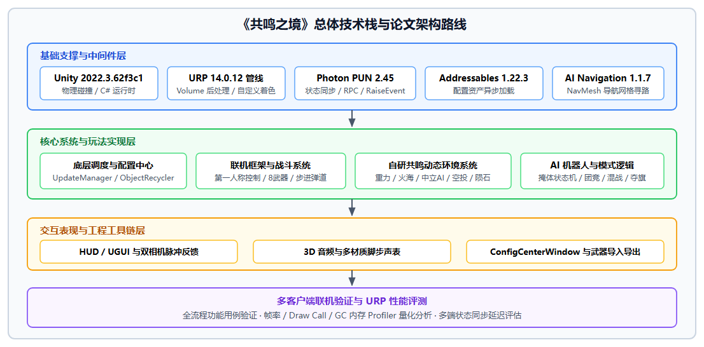

# 1 引言

## 1.1 课题背景与意义

随着实时三维图形渲染技术与高速网络通信基础设施的持续普及，多人在线竞技游戏已成为数字娱乐产业中活跃度最高的品类之一。根据中国音数协游戏工委发布的《2025年中国游戏产业报告》统计数据，2025年国内游戏市场实际销售收入达到3507.89亿元，游戏用户规模达到6.83亿人，保持稳定增长态势[1]。在众多在线游戏形态中，第一人称射击游戏简称FPS，凭借强临场感、高节奏对抗与即时战术协作特性，长期占据竞技游戏的核心份额。此类游戏要求客户端在几十毫秒内完成视角旋转、角色位移、弹道碰撞与伤害广播，对客户端局部流畅度以及多端状态同步一致性提出了较高要求[2]。

传统中小型团队或独立开发者在构建联机FPS作品时，往往面临三类现实难题。其一，自研底层网络传输协议与房间匹配服务开发周期长、稳定性难以保障；其二，传统固定场景地图在进入中后期交火后容易陷入点位固化与节奏单一的僵局，缺乏由玩家战局行为反向重塑战场环境的动态机制；其三，在引入物理碰撞、粒子特效、智能非玩家角色简称AI机器人与高画质渲染后，若缺少统一的帧更新调度、资源对象池与数据驱动配置工具，多客户端并发运行时极易出现垃圾回收抖动与渲染瓶颈。

针对上述问题，本研究基于Unity引擎与Photon Unity Networking 2简称Photon PUN 2联机中间件，设计并实现多人联机第一人称射击游戏《共鸣之境》。在还原经典第一人称移动、八类武器切换、多部位命中判定与团队竞赛、自由混战、夺旗模式对战的基础上，工程自研了一套与战场事件强绑定的“共鸣”动态环境系统。对局中玩家的击中、误伤、旗帜交互与设施破坏行为会实时改变全局共鸣数值，进而联动触发跳跃重力调制、地面火海蔓延、第三阵营中立机器人增援、战区空投补给与高能陨石打击，形成战斗行为与战场环境相互塑造的闭环体验。同时，项目升级并适配了通用渲染管线简称URP、基于Addressables的全局配置加载与编辑器可视化配置工具链，为同类多人联机射击原型的工程化开发提供可复用的设计参考。

## 1.2 国内外研究现状

在多人在线游戏网络同步与延迟治理方面，国外学术界与工业界积累了较为成熟的理论体系。Liu等在《ACM Computing Surveys》发表的综述中，系统梳理了超过80篇网络游戏延迟补偿研究，将客户端预测、状态插值、服务端回溯等11类补偿机制归纳为完整的分类框架[3]。针对竞技FPS对端到端延迟的高度敏感性，Liu等在IEEE QoMEX会议上通过受控实验验证了网络延迟上升会显著降低玩家命中率与主观体验评分，而软件层同步平滑与补偿策略能够有效缓解该衰减[2]。Michaelides与Bellalta进一步在《IEEE Transactions on Games》中对多人FPS常见的“探头优势”现象进行形式化建模，指出客户端渲染帧率、逻辑刷新步长与网络传输延迟的累积会放大交互时空差，强调了插值平滑与权威状态裁决在保证竞技公平性中的核心地位[4]。在商业中间件应用层面，Exit Games提供的Photon PUN 2封装了主服务器匹配、房间属性同步、远程过程调用简称RPC与无视图自定义事件RaiseEvent机制[5]，已在多人VR社交平台CollabVR[6]及严肃联机游戏R3SOLVE[7]等学术原型中得到验证。

国内关于Unity引擎与实时交互系统的研究近年来集中于架构模块化、有限状态机与导航网格寻路等方向。刘端烨与陈立哲在Unity角色控制与商店剧情系统研究中，采用有限状态机与面向对象的模块拆分降低了脚本耦合度，提升了工程可维护性[8]；张瑜等在Unity解谜游戏开发中提出了数据与逻辑解耦的配置加载思路[9]；邓珊珊等结合Unity场景交互与任务流完成了三维冒险游戏原型构建[10]。在智能体寻路方面，朱昌龙与刘黎志研究了多边形导航网格构建与结合漏斗平滑的改进A*算法在Unity3D地图自动寻路中的应用[11]。在渲染与内存性能优化方面，钟林钢等与陈瑛等分别在无人机集群仿真平台与三维文化展示中验证了内存复用机制与模型面数控制对抑制掉帧的重要作用[12][13]。

综合现有研究可见，当前基于Unity的联机原型较多停留在基础坐标同步或单一玩法复刻层面，将第一人称射击对抗与全局状态驱动的动态战场环境深度耦合、并在URP管线与可视化配置工具支撑下开展量化性能评测的研究仍较为少见。《共鸣之境》正是在吸收现有状态插值、有限状态机与导航网格实践经验的基础上，聚焦动态共鸣生态与联机工程化落地展开设计与验证。

## 1.3 开发环境与核心技术栈

《共鸣之境》客户端与编辑器工具链均基于Windows平台开发与验证，核心依赖引擎包及技术选型如下。

1. 游戏引擎与语言环境：采用Unity 2022.3.62f3c1长期支持版本，使用C#语言基于面向对象与基类继承模式编写业务脚本，并借助 `Internal.Enums` 程序集定义文件拆分公共枚举以缩短编译依赖链路。
2. 渲染管线与视觉后处理：项目接入Unity通用渲染管线URP 14.0.12，通过 `URP-HighFidelity` 管线资产管理光照、阴影与抗锯齿；利用URP `Volume` 框架与屏幕空间环境光遮蔽特性实现动态画质开关，并编写 `OverlayURP.shader` 与 `WaterURP.shader` 适配第一人称武器防穿模双相机渲染与场景水体表现[14]。
3. 网络通信与状态同步：采用Photon PUN 2.45版本及其配套Photon Realtime服务[5]。高频位姿与角色状态通过实现 `IPunObservable` 接口的序列化流进行插值同步，离散战斗事件采用 `[PunRPC]` 远程过程调用，全局广播事件采用 `RaiseEvent` 无视图事件机制，房间级公共状态则写入房间自定义属性哈希表实现全员一致分发。
4. 资源调度与智能导航：引入Addressables 1.22.3包管理核心全局配置资产 `GameConfigData` 的异步与同步加载，解耦配置数据与场景预制体引用[15]；引入AI Navigation 1.1.7包管理场景 `NavMeshSurface` 烘焙与 `NavMeshAgent` 运行时路径规划[16]，配合项目自研掩体点管理器实现AI机器人战术走位。
5. 性能监控与工程辅助：利用Unity Profiler、Frame Debugger及编辑器扩展接口编写集中更新调度器 `UpdateManager`、对象池 `ObjectRecycler` 与配置中心窗口 `ConfigCenterWindow`，支撑开发期资产快速迭代与测试期性能采样。

## 1.4 论文组织结构

围绕《共鸣之境》的玩法构思、系统架构、核心模块实现与多端实测验证，本文总体技术路线如图1-1所示，全文共分六章展开论述。

图1-1 《共鸣之境》总体技术栈与论文架构路线

第一章为引言，交代多人联机FPS研发背景、国内外研究现状、开发环境核心技术栈及全文结构。第二章为游戏设计与需求分析，阐述《共鸣之境》的世界观、“共鸣”核心玩法闭环、三种对战模式、八类武器与四套兵种预设、关卡视听设计及系统功能与非功能需求。第三章为联机框架、渲染适配与核心战斗系统实现，剖析集中帧调度与配置基建、Photon PUN 2大厅匹配与状态同步、URP双相机及后处理适配、第一人称移动控制与步进射线弹道实现。第四章为共鸣系统、AI行为与工具链实现，论述 `ResonanceManager` 房主权威同步及五类环境响应机制、`AIBotAgent` 七状态决策与掩体冷却策略、HUD界面音频以及可视化配置工具。第五章为系统测试与性能分析，组织多客户端联机功能测试用例，并基于Unity Profiler采集URP环境下的帧率、Draw Call、内存开销与网络同步延迟数据进行量化分析。第六章为总结与展望，归纳全文工程成果并提出后续可深化演进的方向。
