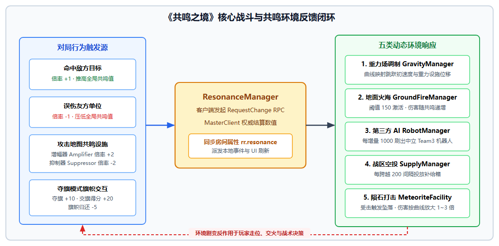
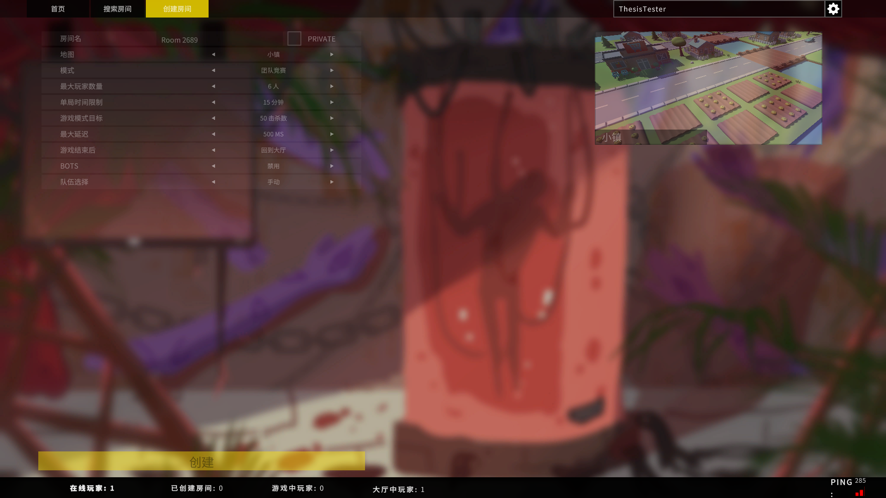
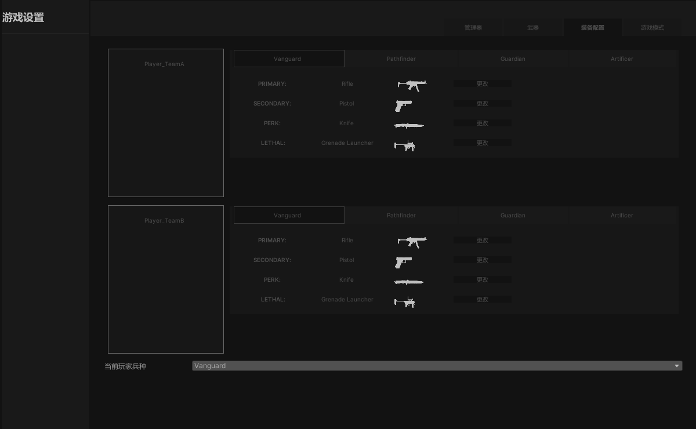

# 2 游戏设计与需求分析

## 2.1 世界观与共鸣核心玩法设计

《共鸣之境》以存在高频能量异常波动的封闭战区为叙事舞台。参战双方小队在小镇街区等空间中展开火力对抗与目标争夺，而战场内部部署了能够感应战斗激烈程度并蓄积能量的“共鸣场”。区别于传统第一人称射击游戏中地形静态不变、交火节奏单向消耗的设计，《共鸣之境》将玩家的微观战斗行为直接转化为宏观战场规则的调制信号，构建出“交火触发共鸣—共鸣重塑环境—环境反制战术”的闭环玩法，其核心反馈机制如图2-1所示。

图2-1 《共鸣之境》核心战斗与共鸣环境反馈闭环

在单局对抗中，当玩家命中敌方单位、摧毁地图中部署的共鸣增幅器 `Amplifier` 或推进夺旗目标时，全局共鸣值持续攀升；反之，若出现误伤友军、摧毁共鸣抑制器 `Suppressor` 或拦截归还旗帜，则会压低共鸣值。随着共鸣值跨越不同区间与阈值，战场会依次出现低重力高跃迁、多点位地面火焰封锁通道、第三方中立AI机器人介入清场、高价值空投补给坠落争夺以及陨石设施触发范围轰炸等动态变化。玩家在对局中既要关注枪法对抗与阵地控制，也需主动利用或规避不断演变的共鸣环境，使中后期战局保持高频变数与策略博弈空间。

## 2.2 游戏模式与规则设计

为满足不同人数规模与对抗偏好的联机体验，《共鸣之境》在 `GameConfigData` 中配置了团队竞赛 `TeamMatch`、自由混战 `FreeMatch` 与夺旗模式 `CaptureMatch` 三种可玩模式，均支持在创建房间时自定义最大人数、胜利目标值与单局时长。各模式的核心规则与配置参数对照见表2-1。

表2-1 游戏模式规则与房间参数配置表

| 模式名称 | 枚举标识 | 支持AI机器人 | 最小开局人数 | 可选最大人数 | 胜利目标类型 | 可选目标阈值 | 可选单局时长 | 核心胜负判定逻辑 |
| :--- | :--- | :--- | :--- | :--- | :--- | :--- | :--- | :--- |
| 团队竞赛 | `TeamMatch` | 是 | 1 | 2、4、6、8、10、16 | 击杀数 | 50、100、150、200 | 300秒、600秒、900秒、1200秒 | 蓝队与红队累计击杀数先达目标或时间结束高分者胜 |
| 自由混战 | `FreeMatch` | 是 | 1 | 2、4、6、8、12 | 击杀数 | 10、25、50、75 | 300秒、600秒、900秒、1200秒 | 全体玩家与AI各自计分，个人击杀最先达标或限时领先者胜 |
| 夺旗模式 | `CaptureMatch` | 否 | 2 | 2、4、6、8 | 夺取数 | 3、5、7、11 | 300秒、600秒、900秒、1200秒 | 自动分队后夺取敌方基地旗帜并带回己方点位交付得分 |

在团队竞赛与自由混战模式中，系统允许开启AI机器人自动补位机制。当房间内真人数量不足预设槽位时，由房主端生成AI机器人参与对抗；当新玩家加入时则动态替换对应阵营的机器人实体，确保任何时段创建房间均可快速开局。夺旗模式则侧重玩家间纯粹的团队配合与路线博弈，旗帜的拾取、交旗得分与夺回操作均直接向共鸣系统注入或扣除较高权重数值，使每次夺旗拉锯都伴随战场环境烈度的剧烈波动。大厅创建房间界面与自定义参数配置如图2-2所示。

图2-2 大厅创建房间界面与地图模式参数配置

## 2.3 武器装备与兵种配置设计

为覆盖近距离突击、中距离压制、远距离架枪与区域范围封锁等多元战术定位，《共鸣之境》实装了8把可用武器，并在全局武器表中统一维护伤害值、射击间隔、换弹耗时、有效射程、精准度与负重权重。武器负重权重直接作用于角色移动系统，影响持枪奔跑与机动速度，在火力强度与机动能力之间形成平衡约束。具体武器属性参数如表2-2所示。

表2-2 武器基础属性配置表

| 武器编号 | 武器名称 | 武器类型 | 基础伤害 | 射击间隔 | 换弹耗时 | 有效射程 | 精准度系数 | 移动负重权重 | 弹道与伤害特征 |
| :--- | :--- | :--- | :--- | :--- | :--- | :--- | :--- | :--- | :--- |
| 0 | `Rifle` | 自动步枪 | 25 | 0.09秒 | 2.0秒 | 700 | 1 | 2.00 | 全自动连射，步进式重力射线弹道 |
| 1 | `Pistol` | 手枪 | 25 | 0.25秒 | 1.5秒 | 300 | 3 | 1.95 | 半自动副武器，切枪敏捷 |
| 2 | `Shotgun` | 霰弹枪 | 50 | 1.25秒 | 6.0秒 | 100 | 1 | 2.20 | 多弹丸散射，支持逐发装弹与开火打断 |
| 3 | `Grenade` | 手雷 | 80 | 2.00秒 | 2.0秒 | 125 | 1 | 1.70 | 物理抛物线投掷，定时触发球形范围爆炸 |
| 4 | `Sniper` | 狙击步枪 | 100 | 1.80秒 | 3.0秒 | 700 | 5 | 2.20 | 高单发伤害，配备专用开镜光学瞄准遮罩 |
| 5 | `Knife` | 战术匕首 | 60 | 0.70秒 | 1.0秒 | 2 | 1 | 1.60 | 近距球体射线判定，支持任意主枪状态快速挥刀 |
| 6 | `Molotov` | 燃烧瓶 | 20 | 1.00秒 | 1.2秒 | 300 | 2 | 0.00 | 投掷落地后生成持续燃烧伤害区域 |
| 7 | `Grenade Launcher` | 榴弹发射器 | 75 | 2.00秒 | 3.0秒 | 100 | 1 | 2.50 | 发射抛物线榴弹，碰触障碍即刻引爆 |

基于上述武器池，系统为玩家预设了4套兵种配装方案，每套配装均由主武器、副武器、近战武器与战术重武器/投掷物共4个槽位构成，既可通过配置中心装备面板为双阵营预制体定制四槽位映射，也可在运行时设置面板切换当前出战兵种。四类兵种的槽位映射关系见表2-3，四类兵种预设与四槽位装备配置界面如图2-3所示。

表2-3 四类兵种预设配装表

| 兵种英文标识 | 兵种中文定位 | 主武器槽位 | 副武器槽位 | 近战槽位 | 战术投掷或重火力槽位 | 战术定位说明 |
| :--- | :--- | :--- | :--- | :--- | :--- | :--- |
| `Vanguard` | 突击兵 | 自动步枪 | 手枪 | 战术匕首 | 榴弹发射器 | 兼顾中近距离持续输出与掩体后目标爆破 |
| `Artificer` | 工程兵 | 霰弹枪 | 手枪 | 战术匕首 | 燃烧瓶 | 擅长室内近战爆发与通道火焰封锁 |
| `Pathfinder` | 侦察兵 | 狙击步枪 | 手枪 | 战术匕首 | 手雷 | 负责远程架点狙杀与高威胁点位投掷破点 |
| `Guardian` | 支援兵 | 自动步枪 | 手枪 | 战术匕首 | 燃烧瓶 | 提供稳定中距离火力掩护并协同阻滞敌方推进 |

图2-3 四类兵种预设与四槽位装备配置界面

## 2.4 共鸣触发与环境响应设计

共鸣系统是区别《共鸣之境》与传统联机模板的核心玩法层设计。项目通过独立的可编程配置资产将“触发系数”与“环境响应阈值”完全参数化，使数值策划能够直接在配置中心微调对局节奏。在 `ResonanceConfig` 中共定义了8类共鸣触发键，而环境端则挂接了5种差异化响应实体。具体触发因子与响应阈值规范见表2-4。

表2-4 共鸣值触发因子与环境响应阈值表

| 所属模块 | 配置资产 | 核心触发键或机制名称 | 数值规则与触发条件 | 实际战场表现 |
| :--- | :--- | :--- | :--- | :--- |
| 数值触发 | `ResonanceConfig` | `Enemy` / `Teammate` | 命中敌方倍率 +1；误伤友方倍率 -1 | 鼓励精准压制敌方并惩罚无效友军误伤 |
| 数值触发 | `ResonanceConfig` | `Amplifier` / `Suppressor` | 增幅器受击倍率 +2；抑制器受击倍率 -2 | 双方围绕中立共鸣设施展开加速或降温争夺 |
| 数值触发 | `ResonanceConfig` | `FlagPickUp` / `FlagCapture` / `FlagRecover` | 夺旗 +10；交旗 +20；归还 -5 | 将夺旗模式高潮节点转化为环境突发事件 |
| 环境响应 | `GravityConfig` | 跳跃重力调制 `GravityManager` | 曲线线性映射共鸣区间 -5000 至 5000 到跳跃初速度 -25 至 35 | 高共鸣下赋予玩家高空跃迁机动性并位移重力设施 |
| 环境响应 | `GroundFireConfig` | 地面火海 `GroundFireManager` | 激活阈值 150；伤害随共鸣 0 至 1000 线性升至 20 | 战区预设火点激活燃烧区域，压缩蹲点空间 |
| 环境响应 | `RobotConfig` | 中立AI增援 `RobotManager` | 共鸣增量步长 1000 | 每跨越千点间隔在战区刷出第三阵营中立机器人 |
| 环境响应 | `SupplyConfig` | 战区空投 `SupplyManager` | 共鸣增量步长 200 | 在预设空投区投放补给箱，提供恢复或重装资源 |
| 环境响应 | `MeteoriteConfig` | 陨石设施 `MeteoriteFacility` | 触发概率 1，延迟 0.5 秒以速度 20 坠落，基础伤害 50，倍率曲线 1 至 3 倍 | 射击激活陨石坠击目标区，共鸣越高毁伤越强 |

## 2.5 场景关卡与视听交互设计

在场景与关卡设计方面，项目在Build Settings中构建了主菜单大厅 `MainMenu` 以及两张可游玩对战地图，即主打立体街区巷战与高低差屋顶交火的“小镇”场景 `OldQuarter` 与用于功能验证及快速对抗的“测试”场景 `Test`。两张对战地图均已提前烘焙完整的 `NavMesh` 导航网格资产，并布置了双阵营出生点、AI掩体节点 `AICoverSpot`、地图可拾取武器点位、可交互门体、梯子以及共鸣增幅/抑制设施与空投区域，支持玩家通过滑铲、攀爬与低重力跳跃实现立体空间机动。

在视听交互设计方面，项目基于URP管线与 `DefaultGraphics` 全局画质预设，默认开启Bloom泛光、环境光遮蔽SSAO、色差与动态模糊效果，并允许玩家在局内随时开关各项后处理特性以适配不同硬件性能。武器与角色采用双相机分层渲染，配合基于Perlin噪声的相机脉冲震动 `CameraImpulse`、呼吸微动与落地冲击倾斜 `CameraMotionRig`，增强开火后坐力与受击反馈。音频系统整合了3D空间距离衰减曲线、房间音效库与多材质脚步声映射表，能够依据角色脚下地面标签或地形贴图层实时切换混凝土、金属、木质等不同材质脚步声，辅助玩家通过听声辨位预判敌情。

## 2.6 系统需求分析

依据上述玩法设计与实际工程结构，《共鸣之境》需要满足以下功能性需求与非功能性需求，系统总体功能结构如图2-4所示。

图2-4 《共鸣之境》系统总体功能结构图

### 2.6.1 功能性需求

1. 联机大厅与房间管理需求：支持客户端连接Photon指定区域服务器、校验登录凭证与防重复会话、浏览并筛选房间列表、按模式/地图/人数/时长/是否启用AI与共鸣创建自定义房间、快速随机匹配、准备大厅自动分队与准备就绪同步，并支持断线返回主菜单及离线单机调试模式。
2. 第一人称角色与战斗需求：支持行走、奔跑、潜行、蹲伏含头顶遮挡检测、滑铲含冷却与前方碰撞检测、攀爬梯子、跳跃动量继承与滑翔控制；支持4槽位武器切换、快速近战挥刀、快速投掷、整匣与逐发可打断换弹、受击方向指示、出生5秒无敌保护、自动回血、7秒倒计时死亡观战及复活流程。
3. 多模式结算与共鸣联动需求：支持团队竞赛与自由混战的击杀积分判定、夺旗模式的拿旗/掉旗/归还/交旗完整状态流转及胜负结算界面；支持共鸣值由房主权威结算并通过房间属性分发，准确驱动5类动态环境响应。
4. AI机器人行为需求：支持由房主统一托管AI决策、自动补齐缺失人数并在真人进入时优雅替换；支持AI在 `NavMesh` 上执行巡逻、发现目标追击、视线遮挡检查、掩体点冷却占用及多种武器发射与手雷抛物线投掷；支持在房主意外退出时由新任房主无缝接管存活与待重生AI实体。
5. 可视化配置工具需求：在Unity编辑器内提供集中式配置中心与武器导入导出工具，使开发与策划人员无需修改代码即可增删武器、调整兵种预设与共鸣曲线参数。

### 2.6.2 非功能性需求

1. 实时同步与流畅度需求：在常规联机网络条件下，本地玩家操作需做到零延迟响应，远程玩家与AI机器人的位置、朝向与注视点通过插值平滑呈现，避免明显瞬移与画面抖动；客户端在URP高画质预设下需维持稳定的可玩帧率与可控Draw Call开销。
2. 内存与高频生成控制需求：针对连续射击产生的大量子弹、弹壳、弹孔贴花与命中特效，必须通过对象池复用消除运行时频繁 `Instantiate` 与 `Destroy` 引发的垃圾回收GC尖峰。
3. 模块化与可扩展性需求：各核心系统需通过事件总线 `GameEvents` 与集中帧调度 `UpdateManager` 实现低耦合通信，游戏模式、武器配置、共鸣环境效果与音效库均基于可编程配置对象或基类继承扩展，便于后续功能迭代。
