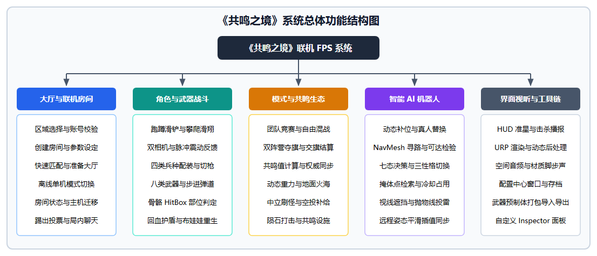

# 2 游戏设计与需求分析

## 2.1 世界观与共鸣核心玩法设计

《共鸣之境》设定在一处存在高频能量异常波动的封闭战区，双方小队在小镇街区中展开火力交锋与目标争夺，战场内还部署了可感应战斗烈度并蓄积能量的“共鸣场”。传统第一人称射击地图的地形与规则通常全程固定，交火节奏容易陷入单向消耗；本游戏将单局中的微观战斗行为直接转译为宏观环境调制信号，使玩家行为与战场条件持续相互影响，其核心反馈机制如图2-1所示。

图2-1 《共鸣之境》核心战斗与共鸣环境反馈闭环

对局过程中，玩家命中敌方、摧毁地图上的共鸣增幅器（`Amplifier`）或推进夺旗进度时，全局共鸣值持续升高；一旦出现误伤友军、击毁共鸣抑制器（`Suppressor`）或夺回并归还旗帜，共鸣值则随之回落。每当共鸣值越过特定阈值区间，场景便会依次出现低重力高跃迁、多点位地面火海封锁通道、第三方中立AI机器人介入清场、战区空投补给坠落以及陨石设施触发范围轰炸等环境变化。对阵双方在拼抢枪法与控制常规点位之外，还必须根据实时波动的共鸣烈度调整走位与进攻路线。

## 2.2 游戏模式与规则设计

为了适配不同在线人数与对抗习惯，《共鸣之境》在 `GameConfigData` 中定义了团队竞赛（`TeamMatch`）、自由混战（`FreeMatch`）与夺旗模式（`CaptureMatch`）三种可玩规则，房主建房时可按需调整最大人数上限、胜利目标阈值及单局时长，具体参数见表2-1。

表2-1 游戏模式规则与房间参数配置表

| 模式名称 | 枚举标识 | 支持AI机器人 | 最小开局人数 | 可选最大人数 | 胜利目标类型 | 可选目标阈值 | 可选单局时长 | 核心胜负判定逻辑 |
| :--- | :--- | :--- | :--- | :--- | :--- | :--- | :--- | :--- |
| 团队竞赛 | `TeamMatch` | 是 | 1 | 2、4、6、8、10、16 | 击杀数 | 50、100、150、200 | 300秒、600秒、900秒、1200秒 | 蓝队与红队累计击杀数先达目标或时间结束高分者胜 |
| 自由混战 | `FreeMatch` | 是 | 1 | 2、4、6、8、12 | 击杀数 | 10、25、50、75 | 300秒、600秒、900秒、1200秒 | 全体玩家与AI各自计分，个人击杀最先达标或限时领先者胜 |
| 夺旗模式 | `CaptureMatch` | 否 | 2 | 2、4、6、8 | 夺取数 | 3、5、7、11 | 300秒、600秒、900秒、1200秒 | 自动分队后夺取敌方基地旗帜并带回己方点位交付得分 |

在团队竞赛与自由混战房间中开启AI补位后，若真人人数少于预设槽位，房主端会自动刷出AI机器人填充对战；新玩家中途进房时，系统随即回收一名对应阵营的机器人让出槽位，避免单人建房后长期空等。夺旗模式暂不启用机器人，侧重双阵营真人小队间的路径配合与拉扯，同时每次拿旗、交旗和夺回操作都会给共鸣系统注入较高的正负权重，促使夺旗交锋阶段伴随更剧烈的战场环境变化。大厅创建房间界面及模式参数如图2-2所示。

图2-2 大厅创建房间界面与地图模式参数配置

## 2.3 武器装备与兵种配置设计

《共鸣之境》实装了8把定位不同的可用武器，用来应对贴脸突击、中距离压制、远程架枪与区域封锁等交战距离。武器伤害、射击间隔、换弹时间、有效射程、精准度与负重权重统一收拢在全局武器表中维护；其中负重权重会直接传入角色移动控制模块，压低持重武器时的奔跑与机动速度，避免高火力武器在移动灵活性上同时占优。各武器核心属性参数如表2-2所示。

表2-2 武器基础属性配置表

| 武器编号 | 武器名称 | 武器类型 | 基础伤害 | 射击间隔 | 换弹耗时 | 有效射程 | 精准度系数 | 移动负重权重 | 弹道与伤害特征 |
| :--- | :--- | :--- | :--- | :--- | :--- | :--- | :--- | :--- | :--- |
| 0 | `Rifle` | 自动步枪 | 25 | 0.09秒 | 2.0秒 | 700 | 1 | 2.00 | 全自动连射，步进式重力射线弹道 |
| 1 | `Pistol` | 手枪 | 25 | 0.25秒 | 1.5秒 | 300 | 3 | 1.95 | 半自动副武器，切枪敏捷 |
| 2 | `Shotgun` | 霰弹枪 | 50 | 1.25秒 | 6.0秒 | 100 | 1 | 2.20 | 多弹丸散射，支持逐发装弹与开火打断 |
| 3 | `Grenade` | 手雷 | 80 | 2.00秒 | 2.0秒 | 125 | 1 | 1.70 | 物理抛物线投掷，定时触发球形范围爆炸 |
| 4 | `Sniper` | 狙击步枪 | 100 | 1.80秒 | 3.0秒 | 700 | 5 | 2.20 | 高单发伤害，配备专用开镜光学瞄准遮罩 |
| 5 | `Knife` | 战术匕首 | 60 | 0.70秒 | 1.0秒 | 2 | 1 | 1.60 | 近距球体射线判定，支持任意主枪状态快速挥刀 |
| 6 | `Molotov` | 燃烧瓶 | 20 | 1.00秒 | 1.2秒 | 300 | 2 | 0.00 | 投掷落地后生成持续燃烧伤害区域 |
| 7 | `Grenade Launcher` | 榴弹发射器 | 75 | 2.00秒 | 3.0秒 | 100 | 1 | 2.50 | 发射抛物线榴弹，碰触障碍即刻引爆 |

基于上述武器池，系统为玩家预设了4套兵种配装方案，每套配装均由主武器、副武器、近战武器与战术重武器/投掷物共4个槽位构成，既可通过配置中心装备面板为双阵营预制体定制四槽位映射，也可在运行时设置面板切换当前出战兵种。四类兵种的槽位映射关系见表2-3，四类兵种预设与四槽位装备配置界面如图2-3所示。

表2-3 四类兵种预设配装表

| 兵种英文标识 | 兵种中文定位 | 主武器槽位 | 副武器槽位 | 近战槽位 | 战术投掷或重火力槽位 | 战术定位说明 |
| :--- | :--- | :--- | :--- | :--- | :--- | :--- |
| `Vanguard` | 突击兵 | 自动步枪 | 手枪 | 战术匕首 | 榴弹发射器 | 兼顾中近距离持续输出与掩体后目标爆破 |
| `Artificer` | 工程兵 | 霰弹枪 | 手枪 | 战术匕首 | 燃烧瓶 | 擅长室内近战爆发与通道火焰封锁 |
| `Pathfinder` | 侦察兵 | 狙击步枪 | 手枪 | 战术匕首 | 手雷 | 负责远程架点狙杀与高威胁点位投掷破点 |
| `Guardian` | 支援兵 | 自动步枪 | 手枪 | 战术匕首 | 燃烧瓶 | 提供稳定中距离火力掩护并协同阻滞敌方推进 |

图2-3 四类兵种预设与四槽位装备配置界面

## 2.4 共鸣触发与环境响应设计

与一般联机射击模板相比，《共鸣之境》的差异点在于把战斗事件倍率与环境触发阈值拆分成了独立的可编程配置资产，调参时无需修改业务脚本就能在配置中心微调对局节奏。`ResonanceConfig` 共维护8类共鸣触发键，下游则由5个环境子模块响应数值变化，各项规则与实际战场效果汇总如表2-4。

表2-4 共鸣值触发因子与环境响应阈值表

| 所属模块 | 配置资产 | 核心触发键或机制名称 | 数值规则与触发条件 | 实际战场表现 |
| :--- | :--- | :--- | :--- | :--- |
| 数值触发 | `ResonanceConfig` | `Enemy` / `Teammate` | 命中敌方倍率 +1；误伤友方倍率 -1 | 鼓励精准压制敌方并惩罚无效友军误伤 |
| 数值触发 | `ResonanceConfig` | `Amplifier` / `Suppressor` | 增幅器受击倍率 +2；抑制器受击倍率 -2 | 双方围绕中立共鸣设施展开加速或降温争夺 |
| 数值触发 | `ResonanceConfig` | `FlagPickUp` / `FlagCapture` / `FlagRecover` | 夺旗 +10；交旗 +20；归还 -5 | 将夺旗模式高潮节点转化为环境突发事件 |
| 环境响应 | `GravityConfig` | 跳跃重力调制 `GravityManager` | 曲线线性映射共鸣区间 -5000 至 5000 到跳跃初速度 -25 至 35 | 高共鸣下赋予玩家高空跃迁机动性并位移重力设施 |
| 环境响应 | `GroundFireConfig` | 地面火海 `GroundFireManager` | 激活阈值 150；伤害随共鸣 0 至 1000 线性升至 20 | 战区预设火点激活燃烧区域，压缩蹲点空间 |
| 环境响应 | `RobotConfig` | 中立AI增援 `RobotManager` | 共鸣增量步长 1000 | 每跨越千点间隔在战区刷出第三阵营中立机器人 |
| 环境响应 | `SupplyConfig` | 战区空投 `SupplyManager` | 共鸣增量步长 200 | 在预设空投区投放补给箱，提供恢复或重装资源 |
| 环境响应 | `MeteoriteConfig` | 陨石设施 `MeteoriteFacility` | 触发概率 1，延迟 0.5 秒以速度 20 坠落，基础伤害 50，倍率曲线 1 至 3 倍 | 射击激活陨石坠击目标区，共鸣越高毁伤越强 |

## 2.5 场景关卡与视听交互设计

目前 Build Settings 中打包了主菜单大厅 `MainMenu` 与两张对战地图，分别是偏向街区巷战与屋顶高低差交火的“小镇”场景 `OldQuarter`，以及用于快速联机与机制验证的“测试”场景 `Test`。两张地图均已提前烘焙 `NavMesh` 导航网格，内部布设了双阵营出生点、`AICoverSpot` 掩体点位、可拾取武器点、交互门体、梯子及共鸣增幅/抑制与空投区域，玩家可结合滑铲、攀爬与低重力跃迁切入屋顶和二层通道。

画面表现上，客户端基于 URP 管线与 `DefaultGraphics` 预设默认开启 Bloom 泛光、SSAO、色差及动态模糊，局内设置面板支持逐项关闭以适应不同显卡负载。武器手臂与场景几何体采用双相机分层渲染，开火或受击时由 `CameraImpulse` 按Perlin噪声驱动脉冲抖动，移动倾斜与呼吸微动由 `CameraMotionRig` 控制。音频部分同时整合了3D空间衰减曲线与多材质脚步声表，角色移动时能依据脚下地面标签或地形贴图权重切换混凝土、金属、木质等不同音效，帮助玩家靠听觉判断附近敌方的移动方位与地面材质。

## 2.6 系统需求分析

依据上述玩法设计与实际工程结构，《共鸣之境》需要满足以下功能性需求与非功能性需求，系统总体功能结构如图2-4所示。

图2-4 《共鸣之境》系统总体功能结构图

### 2.6.1 功能性需求

1. 联机大厅与房间管理：客户端应能连接 Photon 指定区域服务器并完成账号防重校验，支持筛选房间列表、按模式/地图/人数/时长/AI与共鸣开关创建房间、快速随机匹配以及准备大厅分队就绪，并在断线时退回主菜单或切换离线单机房间进行本地调试。
2. 第一人称角色与战斗需求：支持行走、奔跑、潜行、蹲伏含头顶遮挡检测、滑铲含冷却与前方碰撞检测、攀爬梯子、跳跃动量继承与滑翔控制；支持4槽位武器切换、快速近战挥刀、快速投掷、整匣与逐发可打断换弹、受击方向指示、出生5秒无敌保护、自动回血、7秒倒计时死亡观战及复活流程。
3. 多模式结算与共鸣联动：团队竞赛与自由混战需完成击杀积分与倒计时胜负结算，夺旗模式需覆盖拿旗、掉旗、归还和交旗全流程状态流转；对局期间由房主权威结算共鸣数值并向房间广播，驱动重力、火海、中立机器人、空投与陨石五项环境变化。
4. AI机器人托管与补位：房间真人不足时由房主托管AI执行巡逻、发现目标追击、视线遮挡检查、掩体点冷却占用及武器与手雷攻击；有新玩家进房时自动剔除并回收对应阵营的机器人实体，房主意外掉线后由新任房主重新接管场内存活及待重生机器人控制权。
5. 可视化配置工具需求：在Unity编辑器内提供集中式配置中心与武器导入导出工具，使开发与策划人员无需修改代码即可增删武器、调整兵种预设与共鸣曲线参数。

### 2.6.2 非功能性需求

针对多人射击对操作手感和帧率波动的敏感性，本地按键与视角旋转需即时响应，远程玩家及机器人的位移、朝向和注视点采用插值平滑以减少瞬移感，客户端在 URP 高画质下也应维持稳定的可玩帧率与较低的 Draw Call 开销。同时，连续射击产生的子弹、弹壳、弹孔贴花和命中特效数量较大，必须通过对象池复用消除运行期的频繁内存分配与垃圾回收尖峰。各核心模块之间通过 `GameEvents` 事件总线与 `UpdateManager` 解耦通信，新武器、新模式及新环境效果则依靠可编程配置资产或基类继承来扩展。
