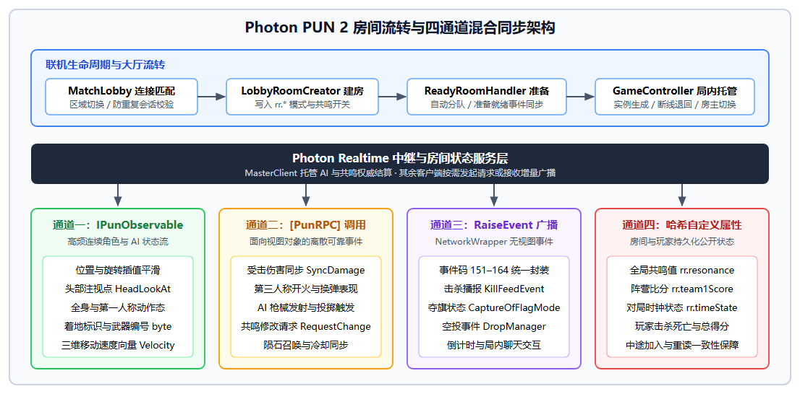

# 3 联机框架、渲染管线与核心战斗系统实现

## 3.1 底层调度与配置资产管理架构

对局期间，玩家控制器、AI机器人、飞行弹道、相机反馈与界面计时器都会高频刷新状态。如果每个脚本各自声明Unity原生的 `Update` 和 `FixedUpdate` 方法，引擎每帧都要在C++底层与C#托管层之间反复跨边界调用，空跑对象也会产生额外开销。工程底层由统一基类与集中帧调度器 `UpdateManager`（图3-1等架构中的生命周期管理核心）统一接管更新：业务脚本在启用和禁用时自动向调度器注册或注销，调度器在注册阶段通过反射识别子类实际重写的更新回调类型，只把存在有效逻辑的实例分别收拢进4个紧凑数组中集中遍历。无需逐帧执行的检查逻辑则放入慢速更新通道，按0.5秒周期触发，避开无效帧运算。

连射弹道和命中粒子若在开火瞬间频繁 `Instantiate` 与 `Destroy`，极易引发堆内存分配抖动。预热对象池模块 `ObjectRecycler` 按照预注册配额在场景加载期提前生成定额子弹、弹壳与特效对象并设为非激活态，利用字典索引和定长循环数组维护池内游标。开火时直接取出游标指向的对象重设位置并激活，命中或飞出射程后清空状态并隐藏归还。

全局参数由基于 `ScriptableObject` 的配置资产持久化保存，覆盖奖惩分值、地图清单、武器表、模式规则与共鸣曲线。运行时通过 Addressables 系统的资源键执行异步协程或按需同步等待读取，编辑器非运行态则直接从资产路径加载，使策划参数与业务脚本相互分离[15]。同时，公共枚举类型单独划入独立程序集编译，修改枚举时不必触发主业务脚本全量重编译。

## 3.2 Photon PUN 2 联机框架与混合通信实现

《共鸣之境》的网络联机层基于Photon PUN 2.45搭建，通过混合使用四种同步通道兼顾实时手感、带宽占用与房间状态一致性，总体同步架构如图3-1所示。

图3-1 Photon PUN 2 房间流转与四通道混合同步架构

### 3.2.1 大厅匹配、准备房间与异常处置

玩家进入主菜单后，大厅连接模块负责区域服务器连线与账号昵称校验；若开启防重复会话检查，建连前会先通过 Photon 好友查询接口核查同一账号是否已在线以拦截重复登录。建房时，系统把模式、地图、目标分数、时长、AI及共鸣开关写入房间自定义属性哈希表；点击快速匹配则尝试随机加入房间，当服务端回调提示暂无可用房间时，客户端立刻自建新房防止匹配卡死。

由于全局配置将房间入口设为准备大厅模式，玩家进房后先进入准备大厅控制器完成自动分队与就绪广播，等待房主确认后统一切入战场。针对无外网测试需求，离线房间模式允许开启 `PhotonNetwork.OfflineMode` 创建本地房间进行单机调试。若对局途中发生网络中断，全局控制器会关闭消息队列并切回主菜单；若房主中途退出，局内控制、计时与AI管理模块会共同响应房主权限切换回调 `OnMasterClientSwitched`，输出系统提示、接管局内计时并重新收集场内所有AI实体转移控制权。

### 3.2.2 四通道混合数据同步机制

根据同步数据对实时性、可靠性和作用域的不同要求，系统将联机通信拆分为4类通道进行协作，各通道的协议载体与同步职责如表3-1所示。

表3-1 联机核心同步通道与协议职责表

| 同步通道 | 实现接口或机制 | 同步范围与触发方式 | 传输内容与作用说明 |
| :--- | :--- | :--- | :--- |
| 状态流同步 | 实现 `IPunObservable` 接口 | 按固定网络发送频率连续序列化 | 传输位置、旋转、头部注视点、全身状态、着地标志、武器ID、第一人称态及速度向量 |
| 面向视图RPC | `[PunRPC]` 远程过程调用（共34个方法） | 绑定网络视图对象按事件触发 | 处理玩家受击扣血、第三人称开火换弹表现、共鸣修改请求与陨石触发 |
| 无视图事件 | `RaiseEvent` 无视图事件机制 | 事件码 151 至 164 全局或分组广播 | 广播踢人、准备状态、聊天、击杀播报、夺旗状态、空投补给、门系统与倒计时 |
| 房间自定义属性 | Photon 房间哈希自定义属性表 | 属性变更增量同步并自动分发新入场端 | 存储房间模式、地图名称、当前共鸣值、阵营得分与玩家个人击杀死亡统计 |

在角色状态流同步中，玩家网络同步组件结合位置与旋转插值控制器平滑远程位移与朝向，并在序列化流中附加发送头部注视坐标、全身状态、着地标志、压缩为单字节的当前武器编号、第一人称动作态以及三维速度向量。远程客户端接收后同步驱动第三人称骨骼动画与头部注视方向，消除远程模型移动僵硬与朝向跳变问题。

## 3.3 URP 渲染管线与动态后处理实现

项目渲染架构基于 URP 14.0.12 构建，`GraphicsSettings` 默认绑定高画质管线资产。渲染子系统围绕第一人称武器防穿墙叠层、城镇河道透明水体着色以及运行时画质与后处理动态调节三项需求展开设计。

第一人称视角贴近墙体时，若场景几何体与手持武器共用同一台相机及深度缓冲区，枪管模型极易穿入建筑网格。在 URP 架构下，工程于双阵营玩家预制体中拆设两台分工明确的相机：场景主相机设为 `Base` 类型，负责输出地形、建筑与远景光照；武器相机设为 `Overlay` 类型并挂入主相机的 `Camera Stack` 栈内，专门绘制第一人称手臂与持枪模型。同时自研前景叠加着色器在 `SubShader` 中声明 `"RenderPipeline" = "UniversalPipeline"` 与 `"Queue" = "Overlay"`，通过 `ZTest Always` 强制深度测试通过并开启 `ZWrite On`，保证手臂和枪械始终渲染于前景。双相机叠加效果如图3-2所示。

图3-2 URP 双相机叠加与第一人称持枪渲染效果

场景水面采用支持前向路径的自研透明水体着色器，标记 `"LightMode" = "UniversalForward"` 并引入 `DeclareDepthTexture.hlsl` 深度纹理采样。着色器把水面屏幕坐标与场景深度图做差值得到水深衰减，进而混合深水与浅水色彩，配合双层反向滚动法线波纹及主附光源软阴影计算，还原城镇河道的水面层次。

第三，构建运行时动态后处理控制、质量分档切换与火焰粒子材质链路。后处理控制脚本直接读取主相机挂载的 URP `Volume` 配置文件，响应全局画质切换事件时，通过配置实例动态开关 `Bloom` 泛光、`ChromaticAberration` 色差与 `MotionBlur` 动态模糊；针对环境光遮蔽 SSAO，脚本通过反射检索当前 `UniversalRenderPipelineAsset` 内部的渲染器特征列表，定位屏幕空间环境光遮蔽实例并实时调整其激活状态[14]。同时，工程在 `QualitySettings` 的 6 档画质中分别绑定性能、平衡与高画质三类 URP 管线资产以支持运行时切换，并在地面火海及枪口焰粒子材质中配置灰度转 Alpha 通道纹理、自发光贴图引用与 `Additive` 混合模式，保证粒子火光边缘通透不遮挡背景。

## 3.4 第一人称角色控制与武器战斗系统

### 3.4.1 第一人称移动与双相机反馈

角色移动模块基于Unity `CharacterController` 构建，内部状态覆盖行走、持枪奔跑、潜行、蹲伏、滑铲、爬梯、下坠与滑翔8种动作。起身退出蹲伏前先向上发射射线检测头顶遮挡，防止角色卡进低矮天花板；滑铲附加冷却计时、前方碰撞检查与相机侧倾插值；奔跑速度则依据当前手持武器负重按比例折算，并将跳跃初速度属性开放给共鸣重力系统实时修改。

视角与镜头反馈由视角旋转、开火脉冲震动与镜头动作缓冲三个组件共同控制。视角控制把水平转向留在身体节点、垂直俯仰交给头部节点，支持多帧输入平滑以及随开镜视野FOV比例自动缩放灵敏度；开火与中弹时，震动组件按武器分类预设与Perlin噪声叠加随机脉冲抖动，而动作缓冲组件承担呼吸微动、侧移倾斜与落地缓冲。

### 3.4.2 武器控制、步进射线弹道与伤害结算

武器背包管理模块维护4个装备槽位的切换及地面拾取替换，并允许玩家在持任意主武器时直接触发快速近战挥刀或快速投掷。武器控制模块处理开火模式切换、散射、整匣换弹与霰弹枪、狙击枪的逐发装弹，逐发装弹中途允许直接射击打断。

常规枪械的子弹运动与命中判定由步进弹道控制器 `ShotController` 执行，完整流转过程如图3-3所示。

图3-3 ShotController 步进式重力弹道与部位伤害判定流程

启用拟真重力弹道后，弹道控制器在物理固定帧更新中省去了给每发子弹挂载常驻刚体碰撞体的开销，改用二阶 Heun 改进欧拉法在固定步长内推进弹道坐标：先利用当前重力向量前向欧拉预估下一刻速度，再取当前速度与预估速度的均值乘以步长累加位移，同时在恒定重力加速度下推进飞行速度。未启用拟真弹道时，轨迹则简化为沿当前速度矢量直接线性步进。

命中判定按间隔步长（当前设为3帧）采样：每次到达检测帧时，从上一检测点向当前位置发射忽略触发器的分段 `Physics.Raycast`，并通过碰撞位掩码屏蔽本地角色自身碰撞体。射线命中后分流到四条处理分支：击中玩家骨骼受击部位时按头、胸、臂、腿倍率结算伤害，再向全体客户端广播带缓冲的受击同步 RPC；击中AI则直接扣减机器人生命值；打中共鸣设施就地触发共鸣变更或陨石请求；撞上静态墙体则贴出对应材质弹孔并将子弹重置隐藏归还对象池。角色生命值归零后开启全身物理布娃娃、进入7秒死亡观战倒计时，随后由出生点管理器选点复活并给予5秒无敌保护。至于非枪械武器，匕首通过相机前方半径0.2米的球形射线 `Physics.SphereCast` 判伤，手雷、燃烧瓶与榴弹则分别实现抛物线投掷、持续灼烧区域以及带障碍遮挡校验的爆炸伤害。
