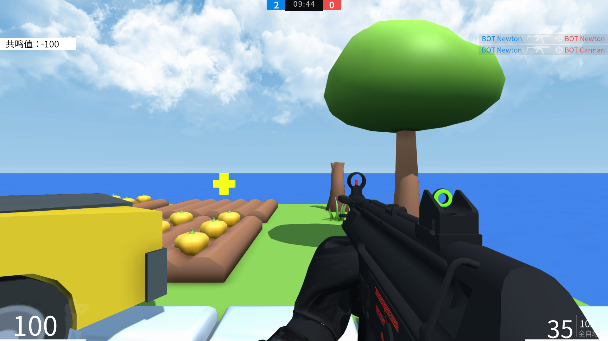

# 3 联机框架、渲染适配与核心战斗系统实现

## 3.1 底层调度与配置资产管理架构

联机第一人称射击游戏在运行期间存在大量高频更新的脚本实体，包括玩家控制器、AI机器人、动态飞行子弹、相机反馈以及界面计时器等。若各业务脚本各自保留Unity原生的 `Update` 与 `FixedUpdate` 魔术方法，将产生频繁的托管与非托管跨边界调用开销。为此，工程在底层设计了由 `MonoBehaviourBase` 基类与集中调度器 `UpdateManager` 构成的统一生命周期管理机制。所有运行时高频脚本均继承自 `MonoBehaviourBase`，该基类继承 `NetworkHelper` 并在对象启用与禁用时自动向 `UpdateManager` 执行注册与注销。`UpdateManager` 在注册阶段通过反射检测子类的 `OnUpdate`、`OnFixedUpdate`、`OnLateUpdate` 与 `OnSlowUpdate` 方法声明类型，仅将实际重写了对应生命周期方法的实例分别放入4组紧凑的 `MonoBehaviourBase` 数组中集中遍历执行，其中 `OnSlowUpdate` 默认按 `0.5f` 秒间隔触发，用于承接无需逐帧运算的周期性状态检测，从架构层面降低了空跑脚本的帧耗时。

针对高频生成与销毁的射击弹道及命中特效，工程在 `ObjectRecycler` 中实现了基于字典索引与定长循环数组的预热对象池。场景初始化阶段，`ObjectRecycler` 依据预注册表 `PreRegister` 预先实例化指定数量的子弹与特效对象并置为非激活状态；开火阶段通过 `ObjectRecycler.Instance.Instantiate` 直接从对应池中按游标 `CurrentPool` 取出对象、重置空间位姿并激活，目标命中或越出射程后仅重置内部变量并设为隐藏，避免运行时频繁分配堆内存导致的垃圾回收卡顿。

在配置管理方面，工程使用 `ScriptableObject` 派生类 `GameConfig` 统一管理全局开关、奖惩分值、地图列表、武器属性表、模式配置表与共鸣参数资产，持久化保存为 `GameConfigData.asset`。运行时通过Unity Addressables资源系统的 `DataAddress` 键以异步协程 `AsyncLoadData` 或按需同步等待加载全局配置实例，并在编辑器非运行态下直接从资产路径读取，实现了逻辑代码与数值策划资产的彻底解耦[15]。同时，所有枚举类型通过独立的 `Internal.Enums.asmdef` 程序集定义文件与主业务脚本分离编译，减少全局修改枚举时的工程重编译耗时。

## 3.2 Photon PUN 2 联机框架与混合通信实现

《共鸣之境》的网络联机层基于Photon PUN 2.45搭建，通过混合使用四种同步通道兼顾实时手感、带宽占用与房间状态一致性，总体同步架构如图3-1所示。


图3-1 Photon PUN 2 房间流转与四通道混合同步架构

### 3.2.1 大厅匹配、准备房间与异常处置

玩家启动游戏进入主菜单后，大厅控制器 `MatchLobby` 实现 `IConnectionCallbacks`、`ILobbyCallbacks` 与 `IMatchmakingCallbacks` 接口，负责区域服务器连接、昵称与凭证校验以及防重复会话检查。当 `guardDuplicateSessions` 开启时，系统通过 `PhotonNetwork.FindFriends` 核查当前账号是否已在线以拦截重复登录。玩家创建房间时，由 `LobbyRoomCreator` 将所选模式、地图名称、目标分数、单局时长、机器人开关与共鸣开关封装为哈希自定义属性写入房间；点击快速匹配则调用 `JoinRandomRoom`，若当前无合适房间触发 `OnNoRoomsToJoin` 回调，系统自动创建一个新房间保证开局连通性。

由于全局配置 `lobbyAccess` 设为 `LobbyAccess.ReadyRoom`，玩家进入房间后先由 `ReadyRoomHandler` 组织准备大厅，支持自动分队与准备就绪状态广播，房主确认后触发全员切入对战场景。同时，`SoloRoom` 支持开启 `PhotonNetwork.OfflineMode` 创建本地离线房间，便于无外网环境下开展单机或AI对抗调试。针对局内网络中断场景，`GameController.OnDisconnected` 会将消息队列标记置为关闭并切回 `MainMenu` 主菜单；针对房主中途退房情况，`GameController`、`MatchTimeManager` 与 `AIManager` 会响应 `OnMasterClientSwitched` 回调，分别负责聊天提示、开局倒计时接管以及重新收集场内所有AI实体以转移控制权。

### 3.2.2 四通道混合数据同步机制

根据同步数据对实时性、可靠性和作用域的不同要求，系统将联机通信拆分为4类通道进行协作，相关自定义事件码与关键属性键如表3-1所示。

表3-1 联机核心同步通道与关键键名规范表

| 同步通道 | 对应接口或封装类 | 典型键名或方法名 | 传输内容与作用说明 |
| :--- | :--- | :--- | :--- |
| 状态流同步 | `PlayerNetworkHandler` 实现 `IPunObservable` | `OnPhotonSerializeView` | 传输位置、旋转、头部注视点、全身状态、着地标志、武器ID、第一人称态及速度向量 |
| 面向视图RPC | `[PunRPC]` 机制，共登记34个方法 | `SyncDamage`、`RPC_RequestChange`、`RPC_TriggerMeteorite` | 处理玩家受击扣血、第三人称开火换弹表现、共鸣修改请求与陨石触发 |
| 无视图事件 | `NetworkWrapper.SendDataOverNetwork` | 事件码 `151` 至 `164` | 广播踢人、准备状态、聊天、击杀播报、夺旗状态、空投补给、门系统与倒计时 |
| 房间自定义属性 | `NetworkKeys` 静态哈希键 | `rr.mode`、`rr.scene`、`rr.resonance`、`rr.team1Score` | 存储房间模式、当前共鸣值、阵营得分与玩家个人击杀死亡统计 |

在角色状态流同步中，`PlayerNetworkHandler` 结合 `PhotonTransformViewPositionControl` 与 `PhotonTransformViewRotationControl` 完成位置与朝向的插值平滑，并在写入流中附加发送头部注视坐标 `GetHeadLookPosition`、全身状态 `PlayerState`、着地状态 `isGrounded`、压缩为 `byte` 类型的当前武器编号、第一人称动作态 `PlayerFPState` 与三维速度向量 `Velocity`。远程客户端接收后在 `OnRemotePlayer` 中同步驱动第三人称骨骼动画与 `HeadTarget` 注视方向，消除远程模型移动僵硬与朝向跳变问题。

## 3.3 URP 渲染管线与自定义后处理适配

为获得更高的渲染可控性与现代后处理表现，项目已从内置渲染管线迁移至URP 14.0.12，`GraphicsSettings` 全局绑定 `URP-HighFidelity` 管线资产。针对第一人称射击游戏特有的视觉需求与画质调控功能，工程重点完成了三项URP专项适配。

第一，解决第一人称持枪模型穿墙与URP双相机叠加问题。第一人称视角下玩家贴近墙体时，武器枪管容易穿插进入场景网格内部。在升级URP后，内置管线原有的 `Depth Only` 清除标志在 `Base` 相机下失效，若第二台相机仍设为 `Base` 类型则会以背景纯色覆盖主相机画面。为此，工程在 `Player_TeamA` 与 `Player_TeamB` 预制体中将场景主相机 `Main Camera` 设为 `Base` 相机，将专用于渲染手臂及枪械的武器相机 `WeaponCamera` 设为 `Overlay` 相机并挂载入主相机的 `Camera Stack` 栈中，同时编写自定义着色器 `OverlayURP.shader`。该着色器在 `SubShader` 标签中显式声明 `"RenderPipeline" = "UniversalPipeline"` 与 `"Queue" = "Overlay"`，在 `Overlay` 通道中设置 `ZTest Always` 强制通过深度测试并开启 `ZWrite On`，通过URP核心库 `Core.hlsl` 完成裁剪空间变换与纹理采样，确保第一人称手臂与武器模型始终稳定叠加渲染于场景前景之上。双相机渲染与URP场景实机效果如图3-2所示。



图3-2 URP 双相机叠加与第一人称持枪渲染效果

第二，适配场景透明水体渲染。工程编写了支持URP前向渲染路径的 `WaterURP.shader`，声明 `"LightMode" = "UniversalForward"` 并引入 `DeclareDepthTexture.hlsl` 深度纹理声明。通过对比场景深度与水面片段屏幕位置计算水深衰减，实现深浅水色插值 `_DepthColor` 与 `_ShallowColor`、双层法线纹理反向滚动波纹以及主光源与附加光源软阴影计算，满足城镇水景区域的立体视觉表现。

第三，重构运行时动态后处理、质量分档与粒子材质适配链路。`PostProcessEffects` 脚本摒弃了旧版内置后处理堆栈依赖，改为读取相机挂载的URP `Volume` 组件配置文件 `PostEffect URP Profile` 与 `DeathCamEffect URP Profile`。在响应全局事件 `GameEvents.onEffectChange` 时，通过 `profile.TryGet` 动态切换 `Bloom` 泛光、`ChromaticAberration` 色差与 `MotionBlur` 动态模糊开关；针对环境光遮蔽SSAO，脚本通过反射检索当前 `UniversalRenderPipelineAsset` 内部的 `m_RendererDataList`，定位名为 `ScreenSpaceAmbientOcclusion` 的 `ScriptableRendererFeature` 实例并实时调整其激活状态[14]。同时，工程在 `QualitySettings` 的 6 档画质中分别绑定 `URP-Performant`、`URP-Balanced` 与 `URP-HighFidelity` 管线资产以支持运行时画质切换，并对 `Particles/Unlit` 火焰及枪口焰粒子材质补齐灰度转 Alpha 通道与 `_EmissionMap` 纹理绑定及 `Additive` 混合模式，消除无透明通道黑底纹理引起的粒子方块异常。

## 3.4 第一人称角色控制与武器战斗系统

### 3.4.1 第一人称移动与双相机反馈

玩家移动核心 `FirstPersonController` 基于Unity `CharacterController` 构建，状态机覆盖站立行走、持枪奔跑、潜行、蹲伏、滑铲、梯子攀爬、自由下坠与滑翔共8种动作姿态。其中，蹲伏切换前执行向上射线检测 `IsHeadHampered` 防止玩家在低矮掩体下强制起身穿顶；滑铲动作带冷却计时、前方障碍检测与相机倾斜角度插值；奔跑速度受手持武器的 `Weight` 权重调制，体现轻重武器的机动差异；同时暴露公开属性 `jumpSpeed` 供共鸣重力系统实时改写。

视角旋转与视觉反馈由 `MouseLook`、`CameraImpulse` 与 `CameraMotionRig` 协同完成。`MouseLook` 分别控制角色身体水平转向与头部相机垂直俯仰，支持过去多帧输入平均平滑以及基于开镜视野FOV比例的灵敏度自动缩放 `AdjustSensitivityBasedOnFOV`。开火与受击时，`CameraImpulse` 依据武器分类对应的震动预设资产生成基于Perlin噪声与随机偏移的相机脉冲抖动；`CameraMotionRig` 则负责呼吸微动、侧移转弯倾斜与落地俯仰缓冲，形成连贯的第一人称操作手感。

### 3.4.2 武器控制、步进射线弹道与伤害结算

`FirearmInventory` 管理玩家4个武器槽位的切换与地图拾取替换，并允许在任意主枪械状态下触发快速近战挥刀或快速投掷。`FirearmController` 封装了开火模式切换、散射控制、整匣换弹 `ReloadPer.Magazine` 与霰弹枪/狙击枪逐发装弹 `ReloadPer.Bullet` 逻辑，其中逐发装弹允许在装填中途随时开火打断以应对突发遭遇战。

常规枪械的子弹运动与命中判定由 `ShotController` 执行，完整流转过程如图3-3所示。


图3-3 ShotController 步进式重力弹道与部位伤害判定流程

当全局开启 `simulatedBallistics` 时，`ShotController.Travel` 在 `OnFixedUpdate` 中不采用简单的瞬时无限速射线，也不依赖高消耗的常驻刚体碰撞体，采用数值稳定性更高的二阶Heun改进欧拉法计算当前固定步长 `timeStep` 下的子弹速度与抛物线坐标：

```csharp
newVelEuler = velocity + timeStep * gravity;
Vector3 newVel = velocity + timeStep * 0.5f * (gravity + gravity);
newPos = newPos + timeStep * 0.5f * (velocity + newVelEuler);
velocity = newVel;
```

同时，系统依据配置参数 `hitTestFrameStep`，当前工程设为3帧，在每隔指定固定帧间隔时，沿上一检测坐标 `oldPos` 至当前坐标 `newPos` 发射分段 `Physics.Raycast`，并利用位掩码屏蔽本地玩家自身碰撞层。命中判定支持4类分支：命中玩家骨骼 `HitBox` 后经 `HitBoxManager` 乘算头、胸、臂、腿部位倍率，通过 `PlayerHealthManager.GetDamage` 向全体端发送带缓冲的 `SyncDamage` RPC；命中AI碰撞体后调用 `AIBotHealth` 结算伤害；命中场景共鸣设施则转发共鸣变更或陨石触发请求；命中静态几何体则生成对应材质弹孔贴花后归还对象池。玩家阵亡后激活全身物理布娃娃 `PlayerRagdoll` 并触发7秒重生倒计时与 `DeathCam` 视角，随后由 `SpawnPointManager` 选择安全出生点完成重生并附带5秒出生无敌保护。近战匕首采用相机前方半径 `0.2f` 的球形射线 `Physics.SphereCast` 判定；手雷、燃烧瓶与榴弹发射器则分别通过 `ProjectileBody`、`DamageArea` 与 `LauncherProjectile` 实现物理抛物线飞行、燃烧持续区与附带遮挡射线检测的范围爆炸伤害。
