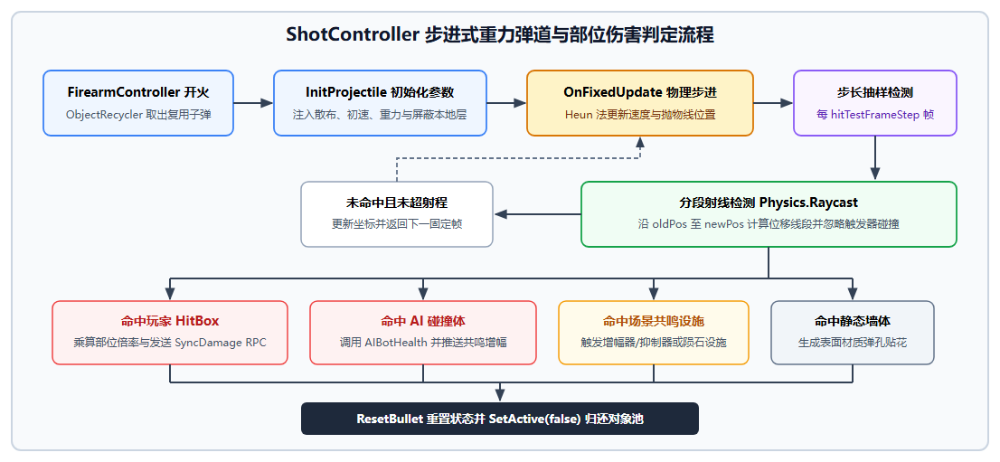

# 3 联机框架、渲染适配与核心战斗系统实现

## 3.1 底层调度与配置资产管理架构

对局期间，玩家控制器、AI机器人、飞行弹道、相机反馈与界面计时器都会高频刷新状态。如果每个脚本各自声明Unity原生的 `Update` 和 `FixedUpdate` 方法，引擎每帧都要在C++底层与C#托管层之间反复跨边界调用，空跑对象也会产生额外开销。工程底层由继承自 `NetworkHelper` 的基类 `MonoBehaviourBase` 与全局调度器 `UpdateManager` 统一接管生命周期：脚本在启用和禁用时自动向管理器注册或注销，管理器注册阶段通过反射识别子类是否重写了 `OnUpdate`、`OnFixedUpdate`、`OnLateUpdate` 与 `OnSlowUpdate`，只把真正实现对应回调的实例分别收拢进4个紧凑数组中集中遍历。无需逐帧执行的检查逻辑可放入 `OnSlowUpdate`，按 `0.5f` 秒周期触发，避开无效帧运算。

连射弹道和命中粒子若在开火瞬间频繁 `Instantiate` 与 `Destroy`，极易引发堆内存分配抖动。`ObjectRecycler` 按照预注册表 `PreRegister` 在场景加载期提前生成定额子弹、弹壳与特效对象并设为非激活态，利用字典索引和循环数组维护各池的游标 `CurrentPool`。开火时直接取出游标指向的对象重设位置并激活，命中或飞出射程后清空状态并隐藏归还。

全局参数由 `ScriptableObject` 派生类 `GameConfig` 持久化保存为 `GameConfigData.asset`，覆盖奖惩分值、地图清单、武器表、模式规则与共鸣曲线。运行时通过 Addressables 系统的 `DataAddress` 键执行异步协程 `AsyncLoadData` 或按需同步等待读取，编辑器非运行态则直接从资产路径加载，使策划参数与业务脚本相互分离[15]。同时，公共枚举类型单独划入 `Internal.Enums.asmdef` 程序集，修改枚举时不必触发主业务脚本全量重编译。

## 3.2 Photon PUN 2 联机框架与混合通信实现

《共鸣之境》的网络联机层基于Photon PUN 2.45搭建，通过混合使用四种同步通道兼顾实时手感、带宽占用与房间状态一致性，总体同步架构如图3-1所示。

图3-1 Photon PUN 2 房间流转与四通道混合同步架构

### 3.2.1 大厅匹配、准备房间与异常处置

玩家进入主菜单后，大厅控制器 `MatchLobby` 实现 `IConnectionCallbacks`、`ILobbyCallbacks` 与 `IMatchmakingCallbacks` 接口，处理区域服务器连线与账号昵称校验；若开启 `guardDuplicateSessions`，建连前会先调用 `PhotonNetwork.FindFriends` 检查同一账号是否已在线以拦截重复登录。由 `LobbyRoomCreator` 建房时，系统把模式、地图、目标分数、时长、AI及共鸣开关写入房间自定义属性哈希表；点击快速匹配则执行 `JoinRandomRoom`，当触发 `OnNoRoomsToJoin` 回调说明暂无可用房间时，客户端立刻自建新房防止匹配卡死。

由于全局配置 `lobbyAccess` 设定为 `LobbyAccess.ReadyRoom`，玩家进房后先进入 `ReadyRoomHandler` 管理的准备大厅完成自动分队与就绪广播，等待房主确认后统一切入战场。针对无外网测试需求，`SoloRoom` 允许开启 `PhotonNetwork.OfflineMode` 创建本地离线房间进行单机调试。若对局途中发生网络中断，`GameController.OnDisconnected` 会关闭消息队列并切回 `MainMenu`；若房主中途退出，则由 `GameController`、`MatchTimeManager` 和 `AIManager` 分别响应 `OnMasterClientSwitched` 回调，输出系统提示、接管局内计时并重新收集场内所有AI实体转移控制权。

### 3.2.2 四通道混合数据同步机制

根据同步数据对实时性、可靠性和作用域的不同要求，系统将联机通信拆分为4类通道进行协作，相关自定义事件码与关键属性键如表3-1所示。

表3-1 联机核心同步通道与关键键名规范表

| 同步通道 | 对应接口或封装类 | 典型键名或方法名 | 传输内容与作用说明 |
| :--- | :--- | :--- | :--- |
| 状态流同步 | `PlayerNetworkHandler` 实现 `IPunObservable` | `OnPhotonSerializeView` | 传输位置、旋转、头部注视点、全身状态、着地标志、武器ID、第一人称态及速度向量 |
| 面向视图RPC | `[PunRPC]` 机制，共登记34个方法 | `SyncDamage`、`RPC_RequestChange`、`RPC_TriggerMeteorite` | 处理玩家受击扣血、第三人称开火换弹表现、共鸣修改请求与陨石触发 |
| 无视图事件 | `NetworkWrapper.SendDataOverNetwork` | 事件码 `151` 至 `164` | 广播踢人、准备状态、聊天、击杀播报、夺旗状态、空投补给、门系统与倒计时 |
| 房间自定义属性 | `NetworkKeys` 静态哈希键 | `rr.mode`、`rr.scene`、`rr.resonance`、`rr.team1Score` | 存储房间模式、当前共鸣值、阵营得分与玩家个人击杀死亡统计 |

在角色状态流同步中，`PlayerNetworkHandler` 结合 `PhotonTransformViewPositionControl` 与 `PhotonTransformViewRotationControl` 完成位置与朝向的插值平滑，并在写入流中附加发送头部注视坐标 `GetHeadLookPosition`、全身状态 `PlayerState`、着地状态 `isGrounded`、压缩为 `byte` 类型的当前武器编号、第一人称动作态 `PlayerFPState` 与三维速度向量 `Velocity`。远程客户端接收后在 `OnRemotePlayer` 中同步驱动第三人称骨骼动画与 `HeadTarget` 注视方向，消除远程模型移动僵硬与朝向跳变问题。

## 3.3 URP 渲染管线与自定义后处理适配

项目已由Built-in内置管线迁移至URP 14.0.12，`GraphicsSettings` 默认绑定 `URP-HighFidelity` 管线资产。这次迁移主要解决了双相机穿墙叠加、透明水体着色以及动态后处理与粒子兼容问题。

第一人称贴近墙体时枪管容易穿入建筑网格，在Built-in管线中武器相机通常通过 `Depth Only` 清除标志盖在主画面之上；然而升级URP后，`Base` 相机强制清除颜色缓冲区，继续保留两台 `Base` 相机只会让武器相机的蓝底直接遮盖整个场景。因此在 `Player_TeamA` 与 `Player_TeamB` 预制体里，`Main Camera` 设为 `Base` 相机，`WeaponCamera` 改为 `Overlay` 相机并挂入主相机的 `Camera Stack` 栈内，再配合自定义 `OverlayURP.shader` 在 `SubShader` 中声明 `"RenderPipeline" = "UniversalPipeline"` 与 `"Queue" = "Overlay"`，通过 `ZTest Always` 强制深度测试通过并开启 `ZWrite On`，保证手臂和枪械始终渲染于前景。双相机叠加效果如图3-2所示。

图3-2 URP 双相机叠加与第一人称持枪渲染效果

场景水面采用支持前向路径的 `WaterURP.shader`，标记 `"LightMode" = "UniversalForward"` 并引入 `DeclareDepthTexture.hlsl` 深度纹理采样。着色器把水面屏幕坐标与场景深度图做差值得到水深衰减，进而混色插值 `_DepthColor` 与 `_ShallowColor`，配合双层反向滚动法线波纹及主附光源软阴影计算，还原城镇河道的水面层次。

第三，重构运行时动态后处理、质量分档与粒子材质适配链路。`PostProcessEffects` 脚本摒弃了旧版内置后处理堆栈依赖，改为读取相机挂载的URP `Volume` 组件配置文件 `PostEffect URP Profile` 与 `DeathCamEffect URP Profile`。在响应全局事件 `GameEvents.onEffectChange` 时，通过 `profile.TryGet` 动态切换 `Bloom` 泛光、`ChromaticAberration` 色差与 `MotionBlur` 动态模糊开关；针对环境光遮蔽SSAO，脚本通过反射检索当前 `UniversalRenderPipelineAsset` 内部的 `m_RendererDataList`，定位名为 `ScreenSpaceAmbientOcclusion` 的 `ScriptableRendererFeature` 实例并实时调整其激活状态[14]。同时，工程在 `QualitySettings` 的 6 档画质中分别绑定 `URP-Performant`、`URP-Balanced` 与 `URP-HighFidelity` 管线资产以支持运行时画质切换，并对 `Particles/Unlit` 火焰及枪口焰粒子材质补齐灰度转 Alpha 通道与 `_EmissionMap` 纹理绑定及 `Additive` 混合模式，消除无透明通道黑底纹理引起的粒子方块异常。

## 3.4 第一人称角色控制与武器战斗系统

### 3.4.1 第一人称移动与双相机反馈

角色移动主体 `FirstPersonController` 挂载在 `CharacterController` 上，内部状态覆盖行走、持枪奔跑、潜行、蹲伏、滑铲、爬梯、下坠与滑翔8种动作。起身退出蹲伏前先向上发射检测射线 `IsHeadHampered`，防止角色卡进低矮天花板；滑铲附加冷却计时、前方碰撞检查与相机侧倾插值；奔跑速度则依据当前手持武器的 `Weight` 属性按比例折算，并将跳跃初速度 `jumpSpeed` 开放为公开属性供共鸣重力系统实时修改。

视角与镜头反馈拆由 `MouseLook`、`CameraImpulse` 与 `CameraMotionRig` 共同控制。`MouseLook` 把水平转向留在身体节点、垂直俯仰交给头部节点，支持多帧输入平滑以及随开镜视野FOV比例缩放灵敏度的 `AdjustSensitivityBasedOnFOV`；开火与中弹时，`CameraImpulse` 按武器分类预设与Perlin噪声叠加随机脉冲抖动，而 `CameraMotionRig` 承担呼吸微动、侧移倾斜与落地缓冲。

### 3.4.2 武器控制、步进射线弹道与伤害结算

`FirearmInventory` 维护4个装备槽位的切换及地面拾取替换，并允许玩家在持任意主武器时直接触发快速近战挥刀或快速投掷。`FirearmController` 处理开火模式切换、散射、整匣换弹（`ReloadPer.Magazine`）与霰弹枪、狙击枪的逐发装弹（`ReloadPer.Bullet`），逐发装弹中途允许直接射击打断。

常规枪械的子弹运动与命中判定由 `ShotController` 执行，完整流转过程如图3-3所示。

图3-3 ShotController 步进式重力弹道与部位伤害判定流程

启用 `simulatedBallistics` 后，`ShotController.Travel` 在 `OnFixedUpdate` 中省去了给每发子弹挂载常驻刚体碰撞体的开销，改用二阶 Heun 改进欧拉法在固定步长 `timeStep` 内推进弹道坐标：先利用当前重力向量前向欧拉预估下一刻速度 `newVelEuler`，再取当前速度与预估速度的均值乘以 `timeStep` 累加位移 `newPos`，同时在恒定重力加速度下推进速度 `velocity`。未启用拟真弹道时，轨迹则简化为沿当前速度矢量直接线性步进。

命中判定按参数 `hitTestFrameStep`（当前设为3帧）间隔采样：每次到达检测帧时，从上一检测点 `oldPos` 向当前点 `newPos` 发射忽略触发器的分段 `Physics.Raycast`，并通过 `bulletMask` 位掩码屏蔽本地角色自身碰撞体。射线命中后分流到四条处理分支：击中玩家骨骼 `HitBox` 时由 `HitBoxManager` 按头、胸、臂、腿倍率结算伤害，再通过 `PlayerHealthManager.GetDamage` 广播带缓冲的 `SyncDamage` RPC；击中AI则直接扣减 `AIBotHealth`；打中共鸣设施就地触发共鸣变更或陨石请求；撞上静态墙体则贴出对应材质弹孔并将子弹重置隐藏归还对象池。角色生命值归零后开启 `PlayerRagdoll` 布娃娃物理、进入7秒 `DeathCam` 倒计时，随后由 `SpawnPointManager` 选点复活并给予5秒无敌保护。至于非枪械武器，匕首通过相机前方半径 `0.2f` 的 `Physics.SphereCast` 判伤，手雷、燃烧瓶与榴弹则分别交由 `ProjectileBody`、`DamageArea` 与 `LauncherProjectile` 处理抛物线投掷、持续灼烧区域以及带障碍遮挡校验的爆炸伤害。
