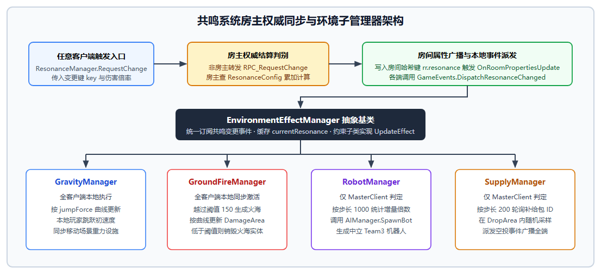
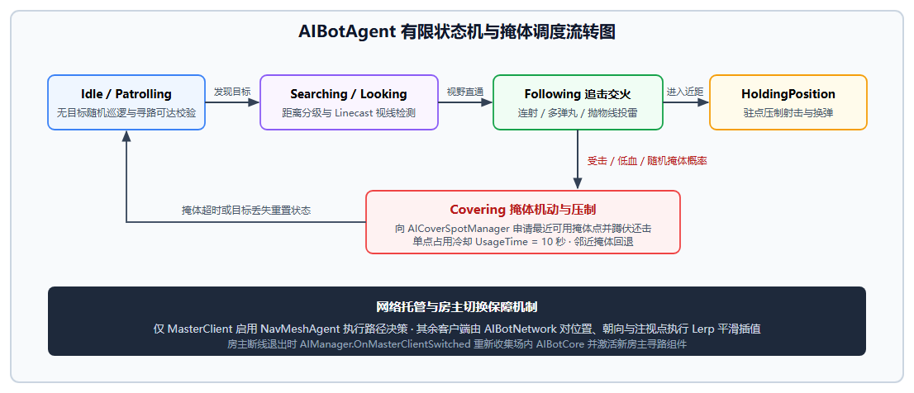
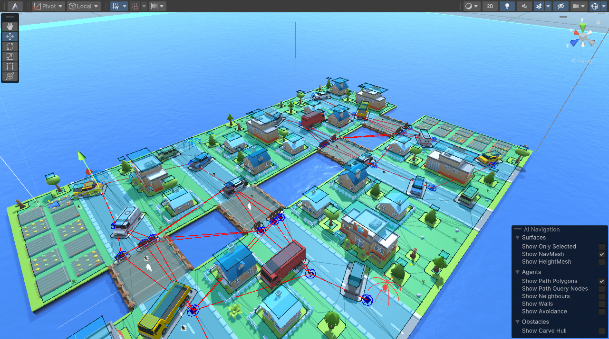

# 4 共鸣系统、AI 行为与工具链实现

## 4.1 共鸣值房主权威同步机制

如果各客户端各自直接改写全局共鸣值，多人同时命中或误伤时就会出现并发覆盖，导致各端地形状态分裂。因此，`Resonance` 模块把数值修改收敛到房主端统一结算，再通过房间属性分发给全部客户端，下游子系统统一继承抽象基类 `EnvironmentEffectManager` 接收更新，整体结构如图4-1所示。

图4-1 共鸣系统房主权威同步与环境子管理器架构

`ResonanceManager` 继承自 `MonoBehaviourBase` 并挂载 `PhotonView`。任意客户端触发有效命中、友军误伤、击中增幅或抑制设施以及夺旗交互时，业务脚本调用静态入口 `ResonanceManager.RequestChange` 传入变更键名与伤害倍率。入口方法先识别本机身份：房主端（`MasterClient`）直接调用 `ChangeResonance` 结算，普通客户端则通过 `RPC_RequestChange` 把请求转交至 `RpcTarget.MasterClient`。

进入 `ChangeResonance` 后，房主端确认全局开关 `resonanceEnabled` 处于开启状态，再从 `ResonanceConfig` 查出对应键的倍率系数，乘以本次权重并累加到 `currentResonance`，最后把新的浮点值写入房间自定义属性 `rr.resonance`。Photon 服务端下发该属性增量后，各端在 `OnRoomPropertiesUpdate` 回调中解析新共鸣值并派发本地事件 `GameEvents.DispatchResonanceChanged`。所有环境管理器均继承 `EnvironmentEffectManager`，基类已在 `OnEnable` 和 `OnDisable` 中封装好事件订阅与本地 `currentResonance` 缓存更新，子类只需重写 `UpdateEffect` 即可接入共鸣响应。

## 4.2 五类动态环境响应与共鸣设施

系统共接入五种受共鸣数值调制的战场环境机制。其中，重力变化与地面火海在各客户端本地按确定性规则同步演算，中立机器人增援、战区空投以及陨石打击涉及随机选点或新实体创建，均收拢到房主端裁决。

重力调制由 `GravityManager` 在本地执行。每当共鸣值变化或本地玩家重生触发 `onLocalPlayerSpawn` 时，脚本根据 `GravityConfig` 中的 `jumpForce` 曲线插值，直接改写本地 `FirstPersonController.jumpSpeed`（共鸣上升时跳跃初速度最高可推高至 35），同时更新场内 `GravityFacility` 重力设施的空间位置。地面火海管理器 `GroundFireManager` 同样在全端本地同步运行，启动时先收集 `GroundFire` 标签节点下的预设火点，只要 `currentResonance` 达到阈值 150，便在各点位实例化 `fireEffectPrefab` 并随共鸣上涨按 `fireDamageCurve` 曲线放大 `DamageArea` 伤害和火焰高度；一旦共鸣值因抑制器或误伤回落至 150 以下，已激活的火海会立即销毁。图4-2给出了共鸣值达到 350 时 `OldQuarter` 城镇地图中的地面火海与 HUD 共鸣提示状态。

图4-2 共鸣值达到350时触发地面火海的实机效果

中立机器人增援和战区空投都只在 `NetworkWrapper.IsMasterClient` 成立时触发，防止多客户端重复生成实体。`RobotManager` 内部记录上一次触发的整数倍阶梯 `lastTriggeredMultiple`，共鸣每跨越 `robotSpawnInterval`（当前设为 1000）的一个步长，就调用 `AIManager.Instance.SpawnBot` 在战区刷出隶属 `Team.Team3` 的中立机器人，同时干扰红蓝两队。`SupplyManager` 则按 `supplyInterval`（当前设为 200）的步长推进，房主轮询 `supplyPackIDs`（配置为 0 号和 1 号补给包），在 `DropArea` 盒型碰撞体内随机采样三维落点并派发 `GameEvents.DispatchDropEvent`，由事件码 `162` 广播全体客户端执行空投降落。

高能陨石设施 `MeteoriteFacility` 继承自 `ResonanceFacility`。子弹击中设施后，非房主端通过 `RPC_RequestMeteorite` 把射击者信息提交给房主；房主校验 1 秒冷却及触发概率，随机锁定敌方一名存活玩家并广播 `RPC_TriggerMeteorite`。所有客户端在 0.5 秒延迟后依据当前共鸣值采样 `damageCurve`（在共鸣 0 至 100 区间对应 1 至 3 倍倍率），以 50 基础伤害乘算倍率并在目标上方以 20 的下落速度生成 `MeteoriteProjectile`；实际碰撞扣血仅由 `isNetwork` 设为 `false` 的房主端实例结算，其余客户端只同步视觉坠落与预警标记。

## 4.3 基于 NavMesh 与掩体冷却的 AI 机器人系统

针对单局人数不足补位及第三方中立AI对抗需求，工程在 `AI` 目录下实现了基于有限状态机、`NavMesh` 寻路与掩体点冷却调度的机器人系统，核心状态流转如图4-3所示。

图4-3 AIBotAgent 有限状态机与掩体调度流转图

全局托管由 `AIManager` 负责，它依据房间人数上限与当前真人数量生成 `BotTeam1`、`BotTeam2` 或 `BotTeam3` 实体。当新玩家中途加入房间，脚本调用 `ReplaceBotWithPlayer` 踢出并回收一名对应阵营的机器人让出位置；玩家离开时再补回机器人保持对局规模。寻路组件 `NavMeshAgent` 与行为状态机只在 `MasterClient` 上运行，其余客户端通过 `AIBotNetwork` 在 `OnUpdate` 中对同步传来的坐标、朝向及 `aimTarget` 注视点做 `Vector3.Lerp` 和 `Quaternion.Lerp` 插值，开火和换弹则靠 RPC 触发本地表现。房主意外掉线后，`AIManager.OnMasterClientSwitched` 会遍历场内 `AIBotCore` 列表，把存活和待重生机器人的控制权移交新房主。

在单体决策层，`AIBotAgent` 依据 `AIBrainState` 枚举在 `Idle`、`Patrolling`、`Following`、`Covering`、`Looking`、`Searching` 与 `HoldingPosition` 共7种状态间迁移，并支持 `Aggressive`、`Passive` 与 `Protective` 三类行为性格。无目标状态下，机器人调用 `RandomPatrol` 在场景导航网格上随机采样目标点；生成目标坐标前先调用 `IsPositionReachable` 验证 `NavMesh.SamplePosition` 与 `NavMesh.CalculatePath` 路径完整性及垂直高度差，若路径不可达则回退搜索最近可达节点。进入交火后，`AIBotAgent` 在 `OnSlowUpdate` 与 `OnUpdate` 中按 `closeRange`、`mediumRange` 与 `limitRange` 三段距离阈值分级决策追击或驻点压制，并通过 `Physics.Linecast` 执行 `CheckVision` 视线遮挡检验。

为了让机器人懂得躲避火力并避免多个单位挤进同一掩体，工程配套编写了 `AICoverSpot` 与 `AICoverSpotManager`。机器人在受击或随机掩体判定下切入 `Covering` 状态时，管理器在 `MaxDistance` 范围内寻找距离最近且未被占用的掩体点，遇到目标点已被占用则回退查找 `maxNeighborDistance` 内的邻近节点。每个掩体启用后进入 10 秒 `UsageTime` 与 15 秒 `coverColdDown` 冷却周期，并由 `onlyAllowOneBotPerCover` 限制单掩体同时仅服务一个单位。遇到遮挡目标时，武器模块 `AIBotAttack` 还会依据目标距离与俯仰角解算 `GetVelocity` 抛物线初速度投掷手雷。图4-4展示了 `OldQuarter` 地图中烘焙的导航网格及掩体点布设情况。

图4-4 OldQuarter 场景 NavMesh 导航网格与 AICoverSpot 掩体布局

## 4.4 HUD 界面、空间音频与编辑器配置工具链

游戏界面基于 UGUI 与 TextMeshPro 搭建，大厅侧由 `LobbyRoomList`、`LobbyRoomCreatorUI`、`EquipmentWindow` 和 `ReadyRoomUI` 承担房间筛选、参数建房、兵种配装与准备就绪交互；进入战局后由 `PlayerUIBank` 管理血量、姿态图标、倒计时、受击红屏与禁区警告，同时挂接 `ReticlePainter` 动态准星、`SniperScopeOverlay` 狙击镜遮罩、`DamageIndicator` 受击方位箭头、`KillReportUI` 击杀播报、`PlayerScoreboardUI` 战绩板以及 `ResonanceUI` 共鸣实时指示器。

音频调度交由 `AudioManager` 统一控制背景音乐淡入淡出和枪声、爆炸、脚步声的空间衰减距离。角色移动时的脚步音效由 `Footstep` 脚本结合 `FootstepLibrary` 与 `SurfaceMaterialTable` 驱动：每次脚步周期向脚底垂直发射 5 米探测射线，读取静止地面的物体标签或地形贴图权重，按混凝土、金属、木质等材质挑选音效并叠加随机音调微调，再根据潜行、蹲伏、行走与奔跑速度缩放发声间隔和音量。

编辑器工具链存放在 `Editor` 目录中，主要包含两个自定义窗口。一个是从菜单 `项目工具/配置中心` 打开的 `ConfigCenterWindow`，把 `GameConfigData`、`Input_Keyboard`、`Input_Gamepad`、共鸣系统 6 份配置资产、武器属性表、四套兵种预设与模式规则收拢到同一个面板中，调参时不必在工程视图里反复翻找零散预制体。另一个是从 `项目工具/工具/导入武器` 唤起的 `WeaponTransfer` 迁移工具，可以把整把武器预制体、图标及第一人称、第三人称组件参数打包成 `WeaponArchive` 导出或导入其他工程，配合 `GravityFacilityTools` 批量放置工具及 17 个自定义 `Inspector` 面板减少人工漏配错配。图4-5为 `ConfigCenterWindow` 中的共振参数配置页。

图4-5 ConfigCenterWindow 共振参数可视化配置界面
