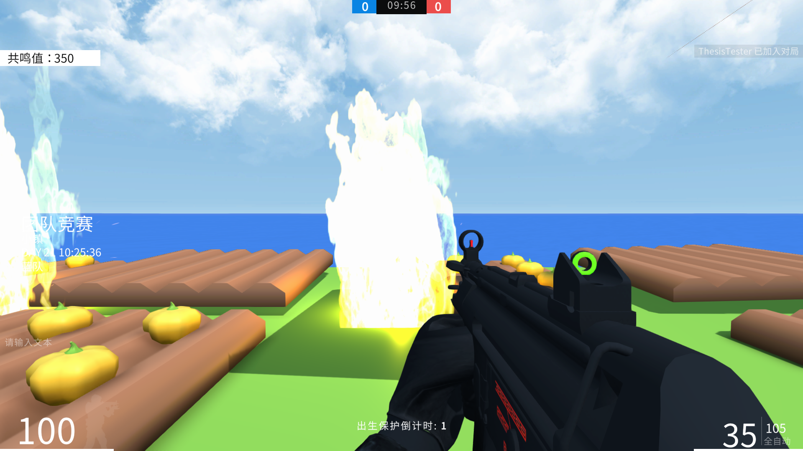
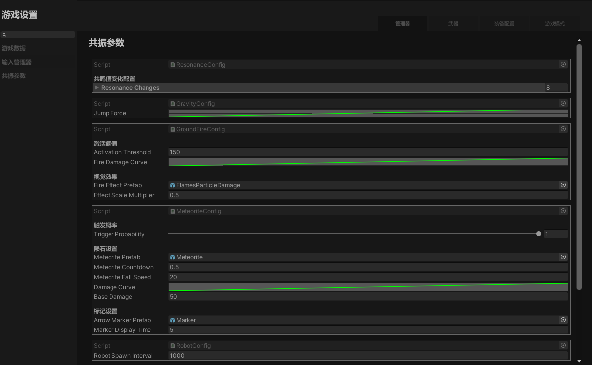

# 4 共鸣系统、AI 行为与工具链实现

## 4.1 共鸣值房主权威同步机制

如果各客户端各自直接改写全局共鸣值，多人同时命中或误伤时就会出现并发覆盖，导致各端地形状态分裂。因此，共鸣系统把数值修改收敛到房主端统一结算，再通过房间属性分发给全部客户端，下游子系统统一继承环境效果基类 `EnvironmentEffectManager` 接收更新，整体结构如图4-1所示。

图4-1 共鸣系统房主权威同步与环境子管理器架构

共鸣入口管理器 `ResonanceManager` 挂载光子视图组件参与联机通信。任意客户端触发有效命中、友军误伤、击中增幅或抑制设施以及夺旗交互时，业务脚本调用静态变更接口传入事件键名与伤害倍率。接口先识别本机身份：房主端（`MasterClient`）直接执行权威结算，普通客户端则通过定向远程过程调用把请求转交至房主端处理。

房主端确认共鸣总开关开启后，先从配置表中查出对应事件的倍率系数，乘以本次权重累加到当前共鸣总值，再把新的浮点值写入房间自定义属性。Photon 服务端下发该属性增量后，各端在房间属性更新回调中解析新共鸣值并派发本地变更事件。所有下游环境管理器均继承 `EnvironmentEffectManager`，基类在启用与禁用阶段封装好事件订阅与当前数值缓存更新，子类只需重写效果刷新方法即可接入共鸣响应。

## 4.2 五类动态环境响应与共鸣设施

系统共接入五种受共鸣数值调制的战场环境机制。其中，重力变化与地面火海在各客户端本地按确定性规则同步演算，中立机器人增援、战区空投以及陨石打击涉及随机选点或新实体创建，均收拢到房主端裁决。

重力调制由 `GravityManager` 在本地执行。每当共鸣值变化或本地角色重生时，模块根据预设跳跃力度动画曲线插值，直接改写本地角色控制器的跳跃初速度（共鸣上升时最高可推高至 35），同时按共鸣比例更新场内重力设施的空间位置。地面火海管理器 `GroundFireManager` 同样在全端本地同步运行，启动时收集场景中预设的火点位置，只要全局共鸣达到阈值 150，便在各点位生成火焰特效并随共鸣上涨按伤害曲线放大燃烧伤害和火焰高度；一旦共鸣值因抑制器或误伤回落至 150 以下，已激活的火海会立即销毁。图4-2给出了共鸣值达到 350 时小镇城镇地图中的地面火海与界面指示状态。

图4-2 共鸣值达到350时触发地面火海的实机效果

中立机器人增援和战区空投都只在房主端触发判定，防止多客户端重复生成实体。中立增援模块 `RobotManager` 内部记录上一次触发的整数倍阶梯，共鸣每跨越 1000 点步长，就在战区刷出隶属第三阵营的中立机器人，同时干扰红蓝两队。战区空投模块 `SupplyManager` 则按 200 点的步长推进，房主轮询0号和1号两类补给包，在预设投放区碰撞体范围内随机采样三维落点并广播空投事件（事件码 162），通知全体客户端执行降落表现。

高能陨石设施 `MeteoriteFacility` 继承自场景共鸣设施基类。子弹击中设施后，非房主端通过远程调用把射击者信息提交给房主；房主校验 1 秒冷却及触发概率，随机锁定敌方一名存活玩家并广播陨石触发消息。所有客户端在 0.5 秒延迟后依据当前共鸣值采样伤害曲线（在共鸣 0 至 100 区间对应 1 至 3 倍倍率），以 50 基础伤害乘算倍率并在目标上方以 20 的下落速度生成陨石投射物；实际碰撞扣血仅由房主端实例结算，其余客户端只同步视觉坠落与预警标记。

## 4.3 基于 NavMesh 与掩体冷却的 AI 机器人系统

针对单局人数不足补位及第三方中立AI对抗需求，工程在AI模块中实现了基于有限状态机、`NavMesh` 寻路与掩体点冷却调度的机器人系统，核心状态流转如图4-3所示。

图4-3 AIBotAgent 有限状态机与掩体调度流转图

全局AI托管层依据房间人数上限与当前真人数量动态生成红队、蓝队或第三阵营机器人。当新玩家中途加入房间，管理器自动踢出并回收一名对应阵营的机器人让出位置；玩家离开时再补回机器人保持对局规模。寻路组件 `NavMeshAgent` 与行为状态机只在 `MasterClient` 上运行，其余客户端在逐帧更新中对同步传来的坐标、朝向及瞄准注视点执行 `Vector3.Lerp` 和 `Quaternion.Lerp` 平滑插值，开火和换弹则靠 RPC 触发本地表现。房主意外掉线后，新房主响应权限切换回调并重新收集场内所有机器人，接管全部存活与待重生单位的控制权。

在单体决策层，`AIBotAgent` 在待机、巡逻、追击、掩护、警戒、搜寻与驻守共7种状态间迁移，并支持激进、保守与防卫三类行为性格。无目标状态下，机器人在场景导航网格上随机采样目标点；生成目标坐标前先调用导航采样与路径计算接口验证路径完整性及垂直高度差，若路径不可达则回退搜索最近可达节点。进入交火后，系统在常规帧与慢速更新周期内按近距、中距与极限距离三段阈值分级决策追击或驻点压制，并通过 `Physics.Linecast` 执行视线遮挡检验。

为了让机器人懂得躲避火力并避免多个单位挤进同一掩体，工程配套编写了掩体点调度模块。机器人在受击或随机掩体判定下切入掩护状态时，调度器在最大搜索半径内寻找距离最近且未被占用的掩体点，遇到目标点已被占用则回退查找邻近可用节点。每个掩体启用后进入 10 秒占用时长与 15 秒冷却周期，并限制同一时间单个掩体仅服务一名机器人。遇到遮挡目标时，武器攻击模块还会依据目标距离与俯仰角解算抛物线初速度投掷手雷。图4-4展示了小镇地图中烘焙的导航网格及掩体点布设情况。

图4-4 小镇场景 NavMesh 导航网格与掩体布局

## 4.4 HUD 界面、空间音频与编辑器配置工具链

游戏界面基于 UGUI 与 TextMeshPro 搭建，大厅侧承担房间列表筛选、参数建房、兵种配装与准备就绪交互；进入战局后统一管理血量、姿态图标、倒计时、受击红屏与禁区警告，同时挂接动态准星、狙击镜遮罩、受击方位箭头、击杀播报、战绩计分板以及共鸣实时数值指示器。

音频调度统一控制背景音乐淡入淡出和枪声、爆炸、脚步声的空间衰减距离。角色移动时的脚步音效结合了声音库资产与表面材质映射表：每次脚步周期向脚底垂直发射 5 米探测射线，读取静止地面的物体标签或地形贴图权重，按混凝土、金属、木质等材质挑选音效并叠加随机音调微调，再根据潜行、蹲伏、行走与奔跑速度缩放发声间隔和音量。

编辑器工具链存放在扩展脚本目录中，主要包含两个通过编辑器顶部自定义菜单唤起的工具窗口。一个是可视化配置中心，把全局游戏数据、键鼠与手柄输入绑定、共鸣系统 6 份配置资产、武器属性表、四套兵种预设与模式规则收拢到同一个面板中，调参时不必在工程视图里反复翻找零散预制体。另一个是武器打包迁移工具，可以把整把武器预制体、图标及第一人称、第三人称组件参数打包导出或导入其他工程，配合场景设施批量布置工具及 17 个自定义检视面板减少人工漏配错配。图4-5为共振参数配置界面的实机效果。

图4-5 共振参数可视化配置界面
