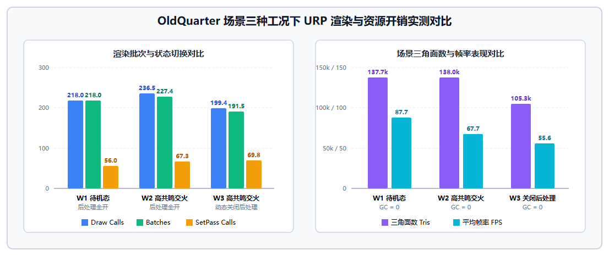

# 5 系统测试与性能分析

## 5.1 测试环境与测试方案设计

联机与渲染测试全部从主菜单入口场景启动，接入 Photon Cloud 海外 `usw` 区域节点后经准备房间进入小镇地图执行，不走本地离线单机分支。测试平台为 Windows 桌面端 Unity 2022.3.62f3c1 编辑器，图形 API 使用 Direct3D 11，开启多线程渲染与垂直同步，全局画质设为最高档 `Ultra`（挂载高画质 URP 管线资产）。

测试分成功能联机检验和帧性能采样两条线。功能部分逐项验证大厅连线、建房分队、切图加载、URP 双相机叠加、共鸣数值同步与五类环境变化、AI 补位寻路以及对象池连续射击复用；性能采样则在小镇场景中设置 3 组受控工况，每次先预热 20 帧再连续记录 120 帧数据，统计非缩放帧耗时、平均帧率 FPS、1% 低帧率、Draw Call、Batches、SetPass Calls、三角面数、已分配总内存、Mono 已用堆内存及第 0 代垃圾回收 Gen0 触发次数。

## 5.2 核心功能与联机同步测试

### 5.2.1 联机通信、模式组件与双相机渲染验证

从主菜单发起连线后，客户端通过 `WebSocketSecure` 传输协议接入 Photon Cloud 的 `usw` 区域大厅，实测大厅阶段往返延迟 RTT 为 235 毫秒至 280 毫秒，切入小镇线上房间后对局内 RTT 稳定在 246 毫秒至 262 毫秒区间，未启用离线回退分支。在小镇对局现场核验了团队竞赛、自由混战与夺旗三种模式控制器均已正常装载，场内 2 个阵营旗帜点位与 30 个 AI 掩体节点就位，6 人上限房间在单名真人玩家入场后自动补位生成 4 至 5 名 AI 机器人。

在 URP 渲染层面，核查双阵营玩家预制体生成的本地玩家相机结构，确认场景主相机为深度 1 的 `Base` 相机并挂载 1 项栈内成员，武器相机为深度 2 的 `Overlay` 相机。实机画面显示第一人称枪械模型无穿墙遮挡且背景小镇地形、天空盒与 HUD 界面完整呈现。同时验证 `QualitySettings` 由低到高共 6 档质量等级已分别绑定性能、平衡与高画质三类 URP 管线资产。

### 5.2.2 共鸣系统、AI 行为与对象池功能用例

针对工程核心创新模块共鸣系统与AI及战斗模块，执行了分阶段阶跃触发实测。各项功能用例的输入条件、观测结果及判定结论汇总如表5-1所示。

表5-1 核心功能与共鸣联动测试用例结果表

| 用例编号 | 测试模块 | 测试操作与输入条件 | 实测观测结果 | 判定结果 |
| :--- | :--- | :--- | :--- | :--- |
| TC-01 | 大厅与准备切图 | 从主菜单登录昵称并创建6人小镇场景团队竞赛房间后点击开始 | 大厅RTT 235毫秒至280毫秒，成功创建房间、自动分队并加载至小镇场景 | 通过 |
| TC-02 | 共鸣重力与属性同步 | 触发共鸣变更接口按敌方命中权重累计推高共鸣至160与1000 | 房间共鸣属性同步更新为160；角色跳跃初速度从初始 5.00 升至160时的 5.96 与1000时的 11.00 | 通过 |
| TC-03 | 共鸣地面火海激活与熄灭 | 共鸣值越过阈值150升至160与350，随后攻击抑制器压低至100 | 共鸣160与350时在场内激活46处火焰伤害点，火焰形态正常无色块；降至100后46处火点全部销毁 | 通过 |
| TC-04 | 共鸣空投与中立AI刷出 | 共鸣值依次跨越步长200与1000 | 跨越200触发2次空投事件；跨越1000后中立刷怪模块生成中立AI，场内机器人数量由5增至6 | 通过 |
| TC-05 | AI状态迁移与寻路 | 在小镇场景30个掩体点环境下观察5至6名AI状态机运行 | 各AI在搜寻与警戒状态间实时巡检切换并正常交火击杀 | 通过 |
| TC-06 | 对象池连续射击复用 | 对当前主武器自动步枪连续触发20次单发开火调用 | 20次弹道生成与步进射线判定均正常完成，期间Gen0垃圾回收触发增量为 0 | 通过 |

表5-1中的6项实测用例均按预期条件触发并完成同步：房间共鸣属性变动后，角色跳跃初速度从初始 5.00 线性爬升至 5.96（共鸣160）与 11.00（共鸣1000）；46 处地面火焰区域在越过阈值 150 后全部开启、回落至 100 时完整销毁，修复贴图与混合模式后的黄色火焰粒子材质未再出现遮挡色块；连续调用 20 次自动步枪单发开火后，Gen0 垃圾回收触发次数保持为 0。

## 5.3 URP 管线与高共鸣场景性能评测

在小镇地图中设置 3 组对照工况，连续采集每组预热后的 120 帧性能指标，观察 URP 渲染与对象池在高并发战斗下的负载表现。工况 W1 为无火海待机且后处理全开；工况 W2 开启 46 处地面火海、多 AI 交火并每 5 帧连射一次，后处理保持全开；工况 W3 保留 W2 相同的火海、AI 与连射负载，但通过动态控制接口关闭 Bloom、SSAO、MotionBlur 与色差。3 组数据见表5-2，对比曲线见图5-1。

表5-2 小镇场景三种工况下 URP 性能实测数据表

| 性能指标 | 工况 W1 待机态全特效 | 工况 W2 高共鸣交火全特效 | 工况 W3 高共鸣交火关闭后处理 | W2 相对 W1 变化 | W3 相对 W2 变化 |
| :--- | :--- | :--- | :--- | :--- | :--- |
| 平均帧耗时 | 11.40 ms | 14.77 ms | 18.00 ms | 上升 29.6% | 上升 21.9% |
| 平均帧率 | 87.7 FPS | 67.7 FPS | 55.6 FPS | 下降 22.8% | 下降 17.9% |
| 1% 低帧率 | 69.4 FPS | 39.7 FPS | 37.8 FPS | 下降 42.8% | 下降 4.8% |
| 平均 Draw Call | 218.0 | 236.5 | 199.4 | 上升 8.5% | 下降 15.7% |
| 平均 Batches | 218.0 | 227.4 | 191.5 | 上升 4.3% | 下降 15.8% |
| 平均 SetPass Calls | 56.0 | 67.3 | 69.8 | 上升 20.2% | 上升 3.7% |
| 平均三角面数 | 137693 | 137988 | 105344 | 上升 0.2% | 下降 23.7% |
| 已分配总内存 | 729.4 MB | 743.8 MB | 747.4 MB | 上升 14.4 MB | 上升 3.6 MB |
| Mono 已用堆内存 | 923.1 MB | 929.1 MB | 935.2 MB | 上升 6.0 MB | 上升 6.1 MB |
| Gen0 垃圾回收增量 | 0 次 | 0 次 | 0 次 | 保持零触发 | 保持零触发 |

图5-1 小镇场景三种工况下 URP 渲染与资源开销实测对比

从 W1 切入激活 46 处火海和高频连射的 W2 状态后，Draw Call 从 218.0 升至 236.5，Batches 从 218.0 升至 227.4，平均帧耗时增加 3.37 ms，平均帧率从 87.7 FPS 降为 67.7 FPS，仍处于可流畅交火区间；不过 1% 低帧率从 69.4 FPS 掉到 39.7 FPS，说明粒子与 AI 同时活动时仍会拉出瞬时帧耗时尖峰。内存开销上，3 组共 360 帧采样期内 Gen0 垃圾回收全部维持 0 次，已分配总内存从 W1 到 W2 仅静态增长 14.4 MB、从 W2 到 W3 仅增加 3.6 MB，预热对象池与集中更新调度没有产生运行时高频堆分配。

至于 W3 关闭四项后处理后出现的数据背离现象，表5-2显示渲染提交量确实下降了，Draw Call 减少 15.7% 至 199.4、场景三角面数降低 23.7% 至 105344，但 SetPass Calls 却微升至 69.8，平均帧率不升反降至 55.6 FPS（18.00 ms）。排查当时的采样环境发现，W3 测试在 Unity 编辑器联网运行期间进行，同一时段场内 AI 机器人恰好密集触发寻路重算、视线射线检测与交火动画切换，编辑器进程与主线程 CPU 逻辑波动抵消了关闭后处理省下的渲染耗时。在前期排除 AI 并发波动、只保留高共鸣连续射击的对照采样中，关闭后处理后 Draw Call 从 288.5 降至 256.3，平均帧率由 62.3 FPS 升至 67.0 FPS，1% 低帧率由 47.3 FPS 升至 53.1 FPS，证实后处理开关本身的渲染减负在没有 CPU 逻辑争抢时能够转化为帧率提升。

## 5.4 测试中发现的问题与解决措施

集成测试从大厅一路走到高共鸣并发场景，期间暴露并修复了三处影响较大且易复现的工程故障。

最先遇到的是切入小镇对局后画面全蓝、只能看到蓝底天空而地形和角色全部消失。检查双阵营玩家预制体后发现，场景主相机与武器相机均默认设为了 `Base` 类型，深度更大的武器相机在每帧绘制前强制清空颜色缓冲区，把默认蓝色背景直接覆盖在了主场景之上。将武器相机设为 `Overlay` 模式并挂入主相机的 `Camera Stack` 之后，前景武器与背景小镇同步恢复正常。

共鸣值推高到 150 激活地面火海后，场内火点一度显示为 46 个大面积纯黄色不透明方块。对比材质球属性排查确认，地面火焰粒子材质所关联的序列帧图集缺少 Alpha 通道、遗漏了自发光贴图引用，同时材质混用了 `Alpha` 混合模式。把纹理导入设置改成灰度转 Alpha 通道、补全自发光贴图并换为 `Additive` 混合后火舌轮廓恢复正常，随后顺带检查修复了枪口焰等 7 个同类粒子材质及 `QualitySettings` 六档画质对应的 URP 管线引用。

在联机接入阶段，测试机使用默认 Photon UDP 协议连线海外 `usw` 名称服务器时频繁报错 `ClientTimeout`，切为 `WebSocketSecure` 协议后大厅登录和建房全程跑通，往返延迟保持在 235 ms 至 280 ms。另外局内控制台偶尔报出双 `AudioListener` 警告，核查属于大厅相机销毁与本地玩家主相机激活交替的那一重叠帧所致，下一帧即自行恢复，不影响声音播放。
